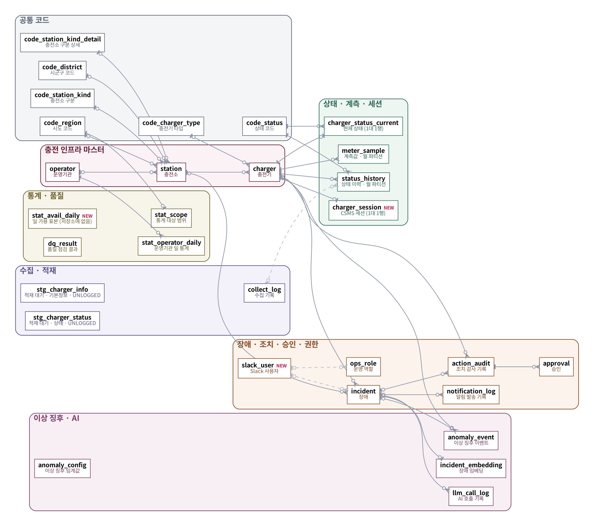

# ChargeOps 테이블 정의서 (스키마 v1.2)

- 기준: **멘토 서버 C 환경 운영 DB (db-01, PostgreSQL 17), 2026-10-23 스키마 덤프** — v1.1(실습 스키마, 10/13)에서 바뀐 곳은 `NEW` 표시
- 만든 방법: 서버에서 `pg_dump --schema-only` 로 받은 스키마를 빈 DB에 적용한 뒤, 카탈로그(테이블 · 컬럼 · 타입 · NULL · 기본값 · 키 · 주석)를 그대로 뽑았습니다. 손으로 쓴 것은 한글 이름뿐입니다.
- WBS 1.4 (DB팀: 조인성 · 강영수 · 윤하빈)

## 0. v1.1 → v1.2 바뀐 점과 정리할 것

| 구분 | 내용 | 비고 |
|---|---|---|
| 테이블 추가 | `charger_session` 충전기 세션 · `slack_user` Slack 사용자 · `stat_avail_daily` 일 가용 표본 | 30개 (v1.1 은 27개) |
| 컬럼 추가 | `incident` 에 `acked_by` · `cause_code` · `detail` · `slack_permalink` | 운영 대시보드 · Slack 연결 |
| 뷰 추가 | 운영 화면용 `v_ops_*` 5개 · `v_charger_card` · `v_fault_duration_daily` | 뷰 · 구체화 뷰 15개 |
| 관계 | 외래 키 25개 (`charger_session` → `charger` 추가) | |
| 임베딩 차원 | `incident_embedding.embedding` = `vector(1024)` (bge-m3) | v1.1 의 결정 ⑦(768/1024) → 1024 로 확정 |
| **저장소에 없는 객체** | `stat_avail_daily` · `fn_add_avail_sample` 은 서버에만 있고 `db/` 마이그레이션에 없음. 부르는 곳도 없음 (0건) | 쓸지 · 지울지 팀 결정 → 쓰면 마이그레이션 추가 |
| 별도 스키마 | `refined` (charger · station · status_daily · status_event) — 정제 예제 결과, 다시 실행하면 새로 만듦 | 운영 정의서 범위 밖 |

## ERD 그림 (v1.2 · 서버 기준)

| 그림 | 내용 |
|---|---|
| [v12_01_map.png](erd/v12_01_map.png) | 주제 영역도 — 7개 영역 · 30개 테이블 · 관계 (`NEW` = v1.1 뒤 추가) |
| [v12_02_logical.png](erd/v12_02_logical.png) | 논리 ERD — 키(PK · FK) 중심 |
| [v12_03_phys_master.png](erd/v12_03_phys_master.png) | 물리 ERD ① 공통 코드 · 충전 인프라 마스터 |
| [v12_04_phys_status.png](erd/v12_04_phys_status.png) | 물리 ERD ② 상태 · 계측 · 세션 · 수집 |
| [v12_05_phys_incident.png](erd/v12_05_phys_incident.png) | 물리 ERD ③ 장애 · 조치 · 승인 · 권한 |
| [v12_06_phys_ai_stats.png](erd/v12_06_phys_ai_stats.png) | 물리 ERD ④ 이상 징후 · AI · 통계 · 품질 |

기호: 까마귀발 = 여러 행, `|` = 꼭 1, `o` = 없을 수 있음, 점선 = 논리 관계(외래 키 없이 값으로만 연결). v1.1 그림(`01_main.png` ~ `10_rules.png`)은 참고용으로 남겨 둡니다.

## 1. 테이블 목록

테이블 30개, 관계(외래 키) 25개, 뷰 · 구체화 뷰 15개.

| # | 영역 | 테이블 | 한글 이름 | 컬럼 | 기본 키 | 물리 설계 |
|---|---|---|---|---|---|---|
| 1 | 공통 코드 | [`code_region`](#code_region) | 시도 코드 | 3 | `code` |  |
| 2 | 공통 코드 | [`code_district`](#code_district) | 시군구 코드 | 3 | `code` |  |
| 3 | 공통 코드 | [`code_station_kind`](#code_station_kind) | 충전소 구분 코드 | 3 | `code` |  |
| 4 | 공통 코드 | [`code_station_kind_detail`](#code_station_kind_detail) | 충전소 구분 상세 코드 | 3 | `code` |  |
| 5 | 공통 코드 | [`code_charger_type`](#code_charger_type) | 충전기 타입 코드 | 3 | `code` |  |
| 6 | 공통 코드 | [`code_status`](#code_status) | 충전기 상태 코드 | 5 | `code` |  |
| 7 | 충전 인프라 마스터 | [`operator`](#operator) | 운영기관 | 6 | `operator_id` |  |
| 8 | 충전 인프라 마스터 | [`station`](#station) | 충전소 | 19 | `station_id` |  |
| 9 | 충전 인프라 마스터 | [`charger`](#charger) | 충전기 | 19 | `charger_id` |  |
| 10 | 상태 · 계측 · 세션 | [`charger_status_current`](#charger_status_current) | 충전기 현재 상태 | 10 | `charger_id` |  |
| 11 | 상태 · 계측 · 세션 | [`status_history`](#status_history) | 충전기 상태 이력 | 11 | `id`, `changed_at` | 파티션 `RANGE (changed_at)` |
| 12 | 상태 · 계측 · 세션 | [`meter_sample`](#meter_sample) | 계측값 | 6 | `charger_id`, `ts` | 파티션 `RANGE (ts)` |
| 13 | 상태 · 계측 · 세션 | [`charger_session`](#charger_session) `NEW` | 충전기 세션 | 5 | `charger_id` |  |
| 14 | 수집 · 적재 | [`collect_log`](#collect_log) | 수집 기록 | 13 | `run_id` |  |
| 15 | 수집 · 적재 | [`stg_charger_info`](#stg_charger_info) | 적재 대기 · 기본정보 | 38 |  | UNLOGGED |
| 16 | 수집 · 적재 | [`stg_charger_status`](#stg_charger_status) | 적재 대기 · 상태 | 9 |  | UNLOGGED |
| 17 | 장애 · 조치 · 승인 · 권한 | [`incident`](#incident) | 장애 | 20 | `incident_id` |  |
| 18 | 장애 · 조치 · 승인 · 권한 | [`action_audit`](#action_audit) | 조치 감사 기록 | 12 | `action_id` |  |
| 19 | 장애 · 조치 · 승인 · 권한 | [`approval`](#approval) | 승인 | 10 | `approval_id` |  |
| 20 | 장애 · 조치 · 승인 · 권한 | [`notification_log`](#notification_log) | 알림 발송 기록 | 7 | `id` |  |
| 21 | 장애 · 조치 · 승인 · 권한 | [`ops_role`](#ops_role) | 운영 역할 | 5 | `slack_user_id`, `valid_from` |  |
| 22 | 장애 · 조치 · 승인 · 권한 | [`slack_user`](#slack_user) `NEW` | Slack 사용자 | 3 | `slack_user_id` |  |
| 23 | 이상 징후 · AI | [`anomaly_event`](#anomaly_event) | 이상 징후 이벤트 | 9 | `anomaly_id` |  |
| 24 | 이상 징후 · AI | [`anomaly_config`](#anomaly_config) | 이상 징후 임계값 | 6 | `id` |  |
| 25 | 이상 징후 · AI | [`llm_call_log`](#llm_call_log) | AI 호출 기록 | 11 | `call_id` |  |
| 26 | 이상 징후 · AI | [`incident_embedding`](#incident_embedding) | 장애 임베딩 | 3 | `incident_id` |  |
| 27 | 통계 · 품질 | [`stat_scope`](#stat_scope) | 통계 대상 범위 | 2 | `region_code` |  |
| 28 | 통계 · 품질 | [`stat_operator_daily`](#stat_operator_daily) | 운영기관별 일 통계 | 7 | `operator_id`, `day` |  |
| 29 | 통계 · 품질 | [`stat_avail_daily`](#stat_avail_daily) `NEW` | 운영기관 · 지역 일 가용 표본 | 6 | `day`, `operator_id`, `region_code` |  |
| 30 | 통계 · 품질 | [`dq_result`](#dq_result) | 데이터 품질 점검 결과 | 6 | `check_date`, `check_name` |  |

## 2. 관계 (외래 키)

| # | 부모 | 자식 | 연결 컬럼 | 부모 : 자식 | 자식 쪽 필수 | 부모 삭제 시 |
|---|---|---|---|---|---|---|
| 1 | `action_audit` 조치 감사 기록 | `approval` 승인 | `action_id` → `action_id` | 1 : 0..N | 예 | NO ACTION |
| 2 | `charger` 충전기 | `action_audit` 조치 감사 기록 | `charger_id` → `charger_id` | 0..1 : 0..N | 아니오 | NO ACTION |
| 3 | `charger` 충전기 | `anomaly_event` 이상 징후 이벤트 | `charger_id` → `charger_id` | 1 : 0..N | 예 | NO ACTION |
| 4 | `charger` 충전기 | `charger_session` 충전기 세션 | `charger_id` → `charger_id` | 1 : 0..1 | 예 | NO ACTION |
| 5 | `charger` 충전기 | `charger_status_current` 충전기 현재 상태 | `charger_id` → `charger_id` | 1 : 0..1 | 예 | NO ACTION |
| 6 | `charger` 충전기 | `incident` 장애 | `charger_id` → `charger_id` | 0..1 : 0..N | 아니오 | NO ACTION |
| 7 | `charger` 충전기 | `meter_sample` 계측값 | `charger_id` → `charger_id` | 1 : 0..N | 예 | NO ACTION |
| 8 | `charger` 충전기 | `status_history` 충전기 상태 이력 | `charger_id` → `charger_id` | 1 : 0..N | 예 | NO ACTION |
| 9 | `code_charger_type` 충전기 타입 코드 | `charger` 충전기 | `code` → `charger_type_code` | 0..1 : 0..N | 아니오 | NO ACTION |
| 10 | `code_district` 시군구 코드 | `station` 충전소 | `code` → `district_code` | 0..1 : 0..N | 아니오 | NO ACTION |
| 11 | `code_region` 시도 코드 | `stat_scope` 통계 대상 범위 | `code` → `region_code` | 1 : 0..1 | 예 | NO ACTION |
| 12 | `code_region` 시도 코드 | `station` 충전소 | `code` → `region_code` | 0..1 : 0..N | 아니오 | NO ACTION |
| 13 | `code_station_kind` 충전소 구분 코드 | `station` 충전소 | `code` → `kind_code` | 0..1 : 0..N | 아니오 | NO ACTION |
| 14 | `code_station_kind_detail` 충전소 구분 상세 코드 | `station` 충전소 | `code` → `kind_detail_code` | 0..1 : 0..N | 아니오 | NO ACTION |
| 15 | `code_status` 충전기 상태 코드 | `charger_status_current` 충전기 현재 상태 | `code` → `status_code` | 1 : 0..N | 예 | NO ACTION |
| 16 | `code_status` 충전기 상태 코드 | `status_history` 충전기 상태 이력 | `code` → `status_code` | 1 : 0..N | 예 | NO ACTION |
| 17 | `incident` 장애 | `action_audit` 조치 감사 기록 | `incident_id` → `incident_id` | 0..1 : 0..N | 아니오 | NO ACTION |
| 18 | `incident` 장애 | `anomaly_event` 이상 징후 이벤트 | `incident_id` → `incident_id` | 0..1 : 0..N | 아니오 | NO ACTION |
| 19 | `incident` 장애 | `incident_embedding` 장애 임베딩 | `incident_id` → `incident_id` | 1 : 0..1 | 예 | NO ACTION |
| 20 | `incident` 장애 | `llm_call_log` AI 호출 기록 | `incident_id` → `incident_id` | 0..1 : 0..N | 아니오 | NO ACTION |
| 21 | `incident` 장애 | `notification_log` 알림 발송 기록 | `incident_id` → `incident_id` | 0..1 : 0..N | 아니오 | NO ACTION |
| 22 | `operator` 운영기관 | `stat_operator_daily` 운영기관별 일 통계 | `operator_id` → `operator_id` | 1 : 0..N | 예 | NO ACTION |
| 23 | `operator` 운영기관 | `station` 충전소 | `operator_id` → `operator_id` | 0..1 : 0..N | 아니오 | NO ACTION |
| 24 | `station` 충전소 | `charger` 충전기 | `station_id` → `station_id` | 1 : 0..N | 예 | NO ACTION |
| 25 | `station` 충전소 | `incident` 장애 | `station_id` → `station_id` | 0..1 : 0..N | 아니오 | NO ACTION |

## 3. 테이블별 정의

### 공통 코드 (Code tables)

#### code_region

**시도 코드** — 시도 코드 (API 필드 zcode). 예: 11 서울특별시, 36 세종특별자치시

| # | 컬럼 | 한글 이름 | 타입 | NULL | 기본값 | 키 | 설명 |
|---|---|---|---|---|---|---|---|
| 1 | `code` | 코드 | `text` | NOT NULL |  | PK | 코드 |
| 2 | `name` | 이름 | `text` | NOT NULL |  |  | 코드의 이름 |
| 3 | `in_guide` | 가이드 등재 | `boolean` | NOT NULL | `true` |  | 가이드 코드표에 있으면 true |

#### code_district

**시군구 코드** — 시군구 코드 (API 필드 zscode). 예: 36110 세종특별자치시

| # | 컬럼 | 한글 이름 | 타입 | NULL | 기본값 | 키 | 설명 |
|---|---|---|---|---|---|---|---|
| 1 | `code` | 코드 | `text` | NOT NULL |  | PK | 코드 |
| 2 | `name` | 이름 | `text` | NOT NULL |  |  | 코드의 이름 |
| 3 | `in_guide` | 가이드 등재 | `boolean` | NOT NULL | `true` |  | 가이드 코드표에 있으면 true |

#### code_station_kind

**충전소 구분 코드** — 충전소 구분 코드 (API 필드 kind). 예: B0 주차시설

| # | 컬럼 | 한글 이름 | 타입 | NULL | 기본값 | 키 | 설명 |
|---|---|---|---|---|---|---|---|
| 1 | `code` | 코드 | `text` | NOT NULL |  | PK | 코드 |
| 2 | `name` | 이름 | `text` | NOT NULL |  |  | 코드의 이름 |
| 3 | `in_guide` | 가이드 등재 | `boolean` | NOT NULL | `true` |  | 가이드 코드표에 있으면 true |

#### code_station_kind_detail

**충전소 구분 상세 코드** — 충전소 구분 상세 코드 (API 필드 kindDetail). 예: B001 공영주차장

| # | 컬럼 | 한글 이름 | 타입 | NULL | 기본값 | 키 | 설명 |
|---|---|---|---|---|---|---|---|
| 1 | `code` | 코드 | `text` | NOT NULL |  | PK | 코드 |
| 2 | `name` | 이름 | `text` | NOT NULL |  |  | 코드의 이름 |
| 3 | `in_guide` | 가이드 등재 | `boolean` | NOT NULL | `true` |  | 가이드 코드표에 있으면 true |

#### code_charger_type

**충전기 타입 코드** — 충전기 타입 코드 (API 필드 chgerType). 예: 02 AC완속, 04 DC콤보

| # | 컬럼 | 한글 이름 | 타입 | NULL | 기본값 | 키 | 설명 |
|---|---|---|---|---|---|---|---|
| 1 | `code` | 코드 | `text` | NOT NULL |  | PK | 코드 |
| 2 | `name` | 이름 | `text` | NOT NULL |  |  | 코드의 이름 |
| 3 | `in_guide` | 가이드 등재 | `boolean` | NOT NULL | `true` |  | 가이드 코드표에 있으면 true |

#### code_status

**충전기 상태 코드** — 충전기 상태 코드 (API 필드 stat). 예: 2 충전대기, 3 충전중

| # | 컬럼 | 한글 이름 | 타입 | NULL | 기본값 | 키 | 설명 |
|---|---|---|---|---|---|---|---|
| 1 | `code` | 코드 | `text` | NOT NULL |  | PK | 코드 |
| 2 | `name` | 이름 | `text` | NOT NULL |  |  | 코드의 이름. 가이드에 없던 코드는 (가이드 미등록) |
| 3 | `in_guide` | 가이드 등재 | `boolean` | NOT NULL | `true` |  | 가이드 코드표에 있으면 true, 실제 데이터에서 처음 나와 자동 등록됐으면 false |
| 4 | `is_down` | 다운으로 봄 | `boolean` | NOT NULL | `false` |  | 가동률 계산에서 "다운"으로 보는 상태면 true (통신이상 · 운영중지 · 점검중 · 고장) |
| 5 | `ocpp_status` | OCPP 상태 대응 | `text[]` | NULL |  |  | 이 코드로 바꿔 저장할 OCPP 1.6 StatusNotification 값들 (CSMS 가 사용) |

### 충전 인프라 마스터 (Master)

#### operator

**운영기관** — 운영기관. 가이드의 기관 코드표로 먼저 채우고, 수집할 때 API 값으로 갱신한다

| # | 컬럼 | 한글 이름 | 타입 | NULL | 기본값 | 키 | 설명 |
|---|---|---|---|---|---|---|---|
| 1 | `operator_id` | 기관 ID | `text` | NOT NULL |  | PK | 기관 ID (API 필드 busiId). 예: ME |
| 2 | `name` | 기관명 | `text` | NULL |  |  | 기관명 (API 필드 bnm). 예: 환경부 |
| 3 | `operating_org` | 운영기관명 | `text` | NULL |  |  | 운영기관명 (API 필드 busiNm). 예: 한국자동차환경협회 |
| 4 | `contact_tel` | 연락처 | `text` | NULL |  |  | 운영기관 연락처 (API 필드 busiCall) |
| 5 | `in_guide` | 가이드 등재 | `boolean` | NOT NULL | `false` |  | 가이드의 기관 코드표에 있으면 true, 실제 데이터에서 처음 나왔으면 false |
| 6 | `updated_at` | 수정 시각 | `timestamptz` | NOT NULL | `now()` |  | 이 행을 마지막으로 고친 시각 |

#### station

**충전소** — 충전소. 한 행 = 충전소 1곳

| # | 컬럼 | 한글 이름 | 타입 | NULL | 기본값 | 키 | 설명 |
|---|---|---|---|---|---|---|---|
| 1 | `station_id` | 충전소 ID | `text` | NOT NULL |  | PK | 충전소 ID (API 필드 statId). 예: PK000434 |
| 2 | `operator_id` | 운영기관 | `text` | NULL |  | FK → `operator` | 운영기관 (API 필드 busiId) → operator.operator_id |
| 3 | `name` | 충전소명 | `text` | NULL |  |  | 충전소명 (API 필드 statNm) |
| 4 | `addr` | 주소 | `text` | NULL |  |  | 주소 (API 필드 addr) |
| 5 | `lat` | 위도 | `numeric(10,7)` | NULL |  |  | 위도 (API 필드 lat). -90~90을 벗어난 값은 비운다 |
| 6 | `lng` | 경도 | `numeric(10,7)` | NULL |  |  | 경도 (API 필드 lng). -180~180을 벗어난 값은 비운다 |
| 7 | `region_code` | 시도 | `text` | NULL |  | FK → `code_region` | 시도 코드 (API 필드 zcode) → code_region.code |
| 8 | `district_code` | 시군구 | `text` | NULL |  | FK → `code_district` | 시군구 코드 (API 필드 zscode) → code_district.code |
| 9 | `kind_code` | 구분 | `text` | NULL |  | FK → `code_station_kind` | 충전소 구분 코드 (API 필드 kind) → code_station_kind.code |
| 10 | `kind_detail_code` | 구분 상세 | `text` | NULL |  | FK → `code_station_kind_detail` | 충전소 구분 상세 코드 (API 필드 kindDetail) → code_station_kind_detail.code |
| 11 | `use_time` | 이용 시간 | `text` | NULL |  |  | 이용 가능 시간 (API 필드 useTime). 예: 24시간 이용가능 |
| 12 | `parking_free` | 주차 무료 | `boolean` | NULL |  |  | 주차료 무료 여부 (API 필드 parkingFree). Y=true, N=false, 그 밖은 비움 |
| 13 | `note` | 안내 | `text` | NULL |  |  | 충전소 안내 (API 필드 note) |
| 14 | `is_restricted` | 이용 제한 | `boolean` | NULL |  |  | 이용자 제한 여부 (API 필드 limitYn). Y=true |
| 15 | `restrict_reason` | 제한 사유 | `text` | NULL |  |  | 이용 제한 사유 (API 필드 limitDetail) |
| 16 | `traffic_yn` | 편의 제공 | `boolean` | NULL |  |  | 편의제공 여부 (API 필드 trafficYn). 가이드에 뜻 설명이 없어 이름을 그대로 둠 |
| 17 | `source` | 출처 | `text` | NOT NULL | `'public'::text` |  | 데이터 출처. public 공공 API, model 모형 충전기, virtual 가상 충전기 |
| 18 | `first_seen_at` | 최초 수집 | `timestamptz` | NOT NULL | `now()` |  | 이 충전소가 처음 들어온 시각 |
| 19 | `updated_at` | 수정 시각 | `timestamptz` | NOT NULL | `now()` |  | 이 행을 마지막으로 고친 시각 |

제약 · 인덱스

- CHECK `((source = ANY (ARRAY['public'::text, 'model'::text, 'virtual'::text])))`
- 인덱스 `station_operator_idx` — `btree (operator_id)`
- 인덱스 `station_region_idx` — `btree (region_code)`

#### charger

**충전기** — 충전기. 한 행 = 충전기 1대

| # | 컬럼 | 한글 이름 | 타입 | NULL | 기본값 | 키 | 설명 |
|---|---|---|---|---|---|---|---|
| 1 | `charger_id` | 충전기 ID | `text` | NOT NULL |  | PK | 충전기 고유 ID. 충전소ID + '-' + 충전기번호. 예: PK000434-01, 모형 CH-01, 가상 LT-0001 |
| 2 | `station_id` | 충전소 | `text` | NOT NULL |  | FK → `station` · UQ | 소속 충전소 (API 필드 statId) → station.station_id |
| 3 | `charger_no` | 충전기 번호 | `text` | NOT NULL |  | UQ | 충전소 안에서의 충전기 번호 (API 필드 chgerId). 예: 01 |
| 4 | `source` | 출처 | `text` | NOT NULL | `'public'::text` |  | 데이터 출처. public 공공 API, model 모형 충전기, virtual 가상 충전기 |
| 5 | `charger_type_code` | 충전기 타입 | `text` | NULL |  | FK → `code_charger_type` | 충전기 타입 코드 (API 필드 chgerType) → code_charger_type.code. v1 의 charger_type |
| 6 | `output_kw` | 출력(kW) | `numeric(7,2)` | NULL |  |  | 충전 용량 kW (API 필드 output). 숫자가 아니면 비움 |
| 7 | `power_type` | 충전 속도 구분 | `text` | NULL |  |  | 충전 속도 구분 (API 필드 powerType). 가이드 명세표에는 없고 실제 응답에 있는 필드 |
| 8 | `charge_method` | 충전 방식 | `text` | NULL |  |  | 충전 방식 (API 필드 method). 단독 또는 동시 |
| 9 | `maker` | 제조사 | `text` | NULL |  |  | 제조사 (API 필드 maker). 가이드에는 없고 실제 응답에 있는 필드 |
| 10 | `install_year` | 설치 연도 | `smallint` | NULL |  |  | 설치 연도 (API 필드 year). 4자리 숫자가 아니면 비움 |
| 11 | `addr_detail` | 주소 상세 | `text` | NULL |  |  | 주소 상세 (API 필드 addrDetail) |
| 12 | `location_detail` | 상세 위치 | `text` | NULL |  |  | 상세 위치 (API 필드 location) |
| 13 | `floor_no` | 층수 | `text` | NULL |  |  | 층수 (API 필드 floorNum) |
| 14 | `floor_type` | 지상 · 지하 | `text` | NULL |  |  | 지상·지하 구분 (API 필드 floorType). F 지상, B 지하 |
| 15 | `is_deleted` | 삭제 여부 | `boolean` | NOT NULL | `false` |  | 철거 등으로 삭제된 충전기면 true (API 필드 delYn). 행은 지우지 않고 표시만 한다 |
| 16 | `delete_reason` | 삭제 사유 | `text` | NULL |  |  | 삭제 사유 (API 필드 delDetail) |
| 17 | `first_seen_at` | 최초 수집 | `timestamptz` | NOT NULL | `now()` |  | 이 충전기가 처음 들어온 시각 |
| 18 | `last_seen_at` | 최종 확인 | `timestamptz` | NOT NULL | `now()` |  | 기본정보 수집에서 마지막으로 확인된 시각. 오래된 값이면 API에서 사라진 충전기 |
| 19 | `rated_current_a` | 정격 전류(A) | `real` | NULL |  |  | 정격 전류(A). C-03 과전류 판단 기준(정격의 120%). 공공 API 에는 없어 공공 충전기는 비움 |

제약 · 인덱스

- CHECK `((source = ANY (ARRAY['public'::text, 'model'::text, 'virtual'::text])))`
- UNIQUE `(station_id, charger_no)`
- 인덱스 `charger_nonpublic_idx` — `btree (charger_id) WHERE (source <> 'public'::text)`
- 인덱스 `charger_station_idx` — `btree (station_id)`

### 상태 · 계측 · 세션 (Status, metrics & session)

#### charger_status_current

**충전기 현재 상태** — 충전기의 현재 상태. 한 행 = 충전기 1대의 가장 최근 상태

| # | 컬럼 | 한글 이름 | 타입 | NULL | 기본값 | 키 | 설명 |
|---|---|---|---|---|---|---|---|
| 1 | `charger_id` | 충전기 | `text` | NOT NULL |  | PK · FK → `charger` | 충전기 → charger.charger_id |
| 2 | `status_code` | 상태 코드 | `text` | NOT NULL |  | FK → `code_status` | 상태 코드 (API 필드 stat) → code_status.code |
| 3 | `changed_at` | 상태 변경 시각 | `timestamptz` | NOT NULL |  |  | 이 상태로 바뀐 시각 (API 필드 statUpdDt) |
| 4 | `last_charge_start_at` | 최근 충전 시작 | `timestamptz` | NULL |  |  | 마지막 충전 시작 일시 (API 필드 lastTsdt) |
| 5 | `last_charge_end_at` | 최근 충전 종료 | `timestamptz` | NULL |  |  | 마지막 충전 종료 일시 (API 필드 lastTedt) |
| 6 | `charging_start_at` | 현재 충전 시작 | `timestamptz` | NULL |  |  | 지금 진행 중인 충전의 시작 일시 (API 필드 nowTsdt) |
| 7 | `source` | 출처 | `text` | NOT NULL | `'public'::text` |  | 데이터 출처 |
| 8 | `received_at` | 수신 시각 | `timestamptz` | NOT NULL | `now()` |  | 이 상태를 받은 시각 |
| 9 | `last_heartbeat_at` | 최근 Heartbeat | `timestamptz` | NULL |  |  | OCPP Heartbeat 를 마지막으로 받은 시각 (60초 넘으면 C-01 통신 두절 후보) |
| 10 | `error_code` | 오류 코드 | `text` | NULL |  |  | 현재 상태의 OCPP errorCode (NoError 면 비움) |

제약 · 인덱스

- CHECK `((source = ANY (ARRAY['public'::text, 'model'::text, 'virtual'::text])))`

#### status_history

**충전기 상태 이력** — 충전기 상태 이력. 한 행 = 상태가 1번 바뀐 것. 바뀐 시각(한국 시간) 기준 월 파티션

- 파티션 `RANGE (changed_at)` (지금 있는 파티션: `status_history_2026_10`, `status_history_2026_11`, `status_history_2026_12`, `status_history_default`)

| # | 컬럼 | 한글 이름 | 타입 | NULL | 기본값 | 키 | 설명 |
|---|---|---|---|---|---|---|---|
| 1 | `id` | 이력 번호 | `bigint` | NOT NULL |  | PK | 이력 번호 (자동 증가) |
| 2 | `changed_at` | 변경 시각 | `timestamptz` | NOT NULL |  | PK · UQ | 상태가 바뀐 시각 (API 필드 statUpdDt). 파티션을 나누는 기준 |
| 3 | `charger_id` | 충전기 | `text` | NOT NULL |  | FK → `charger` · UQ | 충전기 → charger.charger_id |
| 4 | `source` | 출처 | `text` | NOT NULL | `'public'::text` |  | 데이터 출처 |
| 5 | `status_code` | 상태 코드 | `text` | NOT NULL |  | FK → `code_status` · UQ | 바뀐 뒤의 상태 코드 (API 필드 stat) → code_status.code |
| 6 | `error_code` | 오류 코드 | `text` | NULL |  |  | 오류 코드. 공공 API에는 없어 비어 있고, 모형·가상 충전기(OCPP errorCode)가 쓰는 자리 |
| 7 | `last_charge_start_at` | 최근 충전 시작 | `timestamptz` | NULL |  |  | 마지막 충전 시작 일시 (API 필드 lastTsdt) |
| 8 | `last_charge_end_at` | 최근 충전 종료 | `timestamptz` | NULL |  |  | 마지막 충전 종료 일시 (API 필드 lastTedt) |
| 9 | `charging_start_at` | 현재 충전 시작 | `timestamptz` | NULL |  |  | 진행 중인 충전의 시작 일시 (API 필드 nowTsdt) |
| 10 | `received_at` | 수신 시각 | `timestamptz` | NOT NULL | `now()` |  | 이 행을 받아서 넣은 시각. changed_at 과의 차이가 수집 지연 |
| 11 | `run_id` | 수집 실행 번호 | `bigint` | NULL |  |  | 이 행을 넣은 수집 실행 번호 (collect_log.run_id). OCPP 실시간 경로는 비움 |

제약 · 인덱스

- UNIQUE `(charger_id, changed_at, status_code)`
- CHECK `((source = ANY (ARRAY['public'::text, 'model'::text, 'virtual'::text])))`
- 인덱스 `status_history_brin` — `brin (changed_at)`
- 인덱스 `status_history_charger_idx` — `btree (charger_id, changed_at DESC)`

#### meter_sample

**계측값** — 충전기 계측값 (OCPP MeterValues). 이상 징후 감지의 입력. ts 기준 월 파티션

- 파티션 `RANGE (ts)` (지금 있는 파티션: `meter_sample_2026_10`, `meter_sample_2026_11`, `meter_sample_2026_12`, `meter_sample_default`)

| # | 컬럼 | 한글 이름 | 타입 | NULL | 기본값 | 키 | 설명 |
|---|---|---|---|---|---|---|---|
| 1 | `charger_id` | 충전기 | `text` | NOT NULL |  | PK · FK → `charger` |  |
| 2 | `ts` | 계측 시각 | `timestamptz` | NOT NULL |  | PK |  |
| 3 | `current_a` | 전류(A) | `real` | NULL |  |  |  |
| 4 | `voltage_v` | 전압(V) | `real` | NULL |  |  |  |
| 5 | `temp_c` | 온도(℃) | `real` | NULL |  |  |  |
| 6 | `energy_wh` | 누적 전력량(Wh) | `bigint` | NULL |  |  |  |

제약 · 인덱스

- 인덱스 `meter_sample_brin` — `brin (ts)`

#### charger_session

**충전기 세션** `NEW` — 충전기별 현재 OCPP 세션 1개. CSMS 파드가 여러 개일 때 누가 최신 세션인지의 기준

| # | 컬럼 | 한글 이름 | 타입 | NULL | 기본값 | 키 | 설명 |
|---|---|---|---|---|---|---|---|
| 1 | `charger_id` | 충전기 | `text` | NOT NULL |  | PK · FK → `charger` |  |
| 2 | `session_id` | 세션 번호 | `uuid` | NOT NULL |  |  | 접속마다 새로 만드는 세션 번호 (CSMS 가 uuid4 로 생성) |
| 3 | `pod` | CSMS 파드 | `text` | NOT NULL |  |  | 세션을 가진 CSMS 파드 이름 (HOSTNAME) |
| 4 | `pod_ip` | 파드 IP | `text` | NULL |  |  | 그 파드 IP — 원격 명령을 받은 다른 파드가 이 파드로 넘길 때 사용 |
| 5 | `connected_at` | 접속 시각 | `timestamptz` | NOT NULL | `now()` |  |  |

### 수집 · 적재 (Ingestion)

#### collect_log

**수집 기록** — 수집 기록. 한 행 = 수집기를 1번 실행한 것. 실패한 실행도 남는다

| # | 컬럼 | 한글 이름 | 타입 | NULL | 기본값 | 키 | 설명 |
|---|---|---|---|---|---|---|---|
| 1 | `run_id` | 실행 번호 | `bigint` | NOT NULL |  | PK | 실행 번호 (자동 증가) |
| 2 | `operation` | 호출 API | `text` | NOT NULL |  |  | 부른 API. getChargerInfo(기본정보) 또는 getChargerStatus(상태) |
| 3 | `region_code` | 시도 범위 | `text` | NULL |  |  | 수집 범위의 시도 코드. 비어 있으면 전국 |
| 4 | `period_min` | 조회 범위(분) | `int` | NULL |  |  | 상태 수집에서 조회한 범위(분) |
| 5 | `started_at` | 시작 | `timestamptz` | NOT NULL | `now()` |  | 시작 시각 |
| 6 | `finished_at` | 종료 | `timestamptz` | NULL |  |  | 끝난 시각 |
| 7 | `status` | 결과 | `text` | NOT NULL | `'running'::text` |  | running 실행 중, ok 성공, error 실패 |
| 8 | `api_calls` | API 호출 수 | `int` | NULL |  |  | API를 부른 횟수 (하루 호출 한도 계산용) |
| 9 | `rows_fetched` | 받은 건수 | `int` | NULL |  |  | API에서 받은 건수 |
| 10 | `rows_loaded` | 반영 건수 | `int` | NULL |  |  | 실제로 반영된 건수. 기본정보는 충전기 수, 상태는 새로 쌓인 이력 수 |
| 11 | `raw_key` | 원본 위치 | `text` | NULL |  |  | 원본 응답을 보관한 위치 (첫 쪽) |
| 12 | `error_message` | 오류 내용 | `text` | NULL |  |  | 실패했을 때의 오류 내용 |
| 13 | `detail` | 세부 결과 | `jsonb` | NULL |  |  | 적재 함수가 돌려준 세부 결과 (건너뛴 건수, 새로 등록된 코드 등) |

제약 · 인덱스

- CHECK `((status = ANY (ARRAY['running'::text, 'ok'::text, 'error'::text])))`
- 인덱스 `collect_log_started_idx` — `btree (started_at DESC)`

#### stg_charger_info

**적재 대기 · 기본정보** — 적재 대기 · 기본정보. API 응답 37개 필드를 글자 그대로. 실행마다 비우고 채운다

- UNLOGGED (적재 대기용 — 장애 때 비워져도 되는 표)

| # | 컬럼 | 한글 이름 | 타입 | NULL | 기본값 | 키 | 설명 |
|---|---|---|---|---|---|---|---|
| 1 | `stat_nm` |  | `text` | NULL |  |  |  |
| 2 | `stat_id` |  | `text` | NULL |  |  |  |
| 3 | `chger_id` |  | `text` | NULL |  |  |  |
| 4 | `chger_type` |  | `text` | NULL |  |  |  |
| 5 | `addr` |  | `text` | NULL |  |  |  |
| 6 | `addr_detail` |  | `text` | NULL |  |  |  |
| 7 | `location` |  | `text` | NULL |  |  |  |
| 8 | `lat` |  | `text` | NULL |  |  |  |
| 9 | `lng` |  | `text` | NULL |  |  |  |
| 10 | `use_time` |  | `text` | NULL |  |  |  |
| 11 | `busi_id` |  | `text` | NULL |  |  |  |
| 12 | `bnm` |  | `text` | NULL |  |  |  |
| 13 | `busi_nm` |  | `text` | NULL |  |  |  |
| 14 | `busi_call` |  | `text` | NULL |  |  |  |
| 15 | `stat` |  | `text` | NULL |  |  |  |
| 16 | `stat_upd_dt` |  | `text` | NULL |  |  |  |
| 17 | `last_tsdt` |  | `text` | NULL |  |  |  |
| 18 | `last_tedt` |  | `text` | NULL |  |  |  |
| 19 | `now_tsdt` |  | `text` | NULL |  |  |  |
| 20 | `power_type` |  | `text` | NULL |  |  |  |
| 21 | `output` |  | `text` | NULL |  |  |  |
| 22 | `method` |  | `text` | NULL |  |  |  |
| 23 | `zcode` |  | `text` | NULL |  |  |  |
| 24 | `zscode` |  | `text` | NULL |  |  |  |
| 25 | `kind` |  | `text` | NULL |  |  |  |
| 26 | `kind_detail` |  | `text` | NULL |  |  |  |
| 27 | `parking_free` |  | `text` | NULL |  |  |  |
| 28 | `note` |  | `text` | NULL |  |  |  |
| 29 | `limit_yn` |  | `text` | NULL |  |  |  |
| 30 | `limit_detail` |  | `text` | NULL |  |  |  |
| 31 | `del_yn` |  | `text` | NULL |  |  |  |
| 32 | `del_detail` |  | `text` | NULL |  |  |  |
| 33 | `traffic_yn` |  | `text` | NULL |  |  |  |
| 34 | `year` |  | `text` | NULL |  |  |  |
| 35 | `floor_num` |  | `text` | NULL |  |  |  |
| 36 | `floor_type` |  | `text` | NULL |  |  |  |
| 37 | `maker` |  | `text` | NULL |  |  |  |
| 38 | `page_no` |  | `int` | NULL |  |  | 받은 쪽 번호 |

#### stg_charger_status

**적재 대기 · 상태** — 적재 대기 · 상태. API 응답 8개 필드를 글자 그대로. 실행마다 비우고 채운다

- UNLOGGED (적재 대기용 — 장애 때 비워져도 되는 표)

| # | 컬럼 | 한글 이름 | 타입 | NULL | 기본값 | 키 | 설명 |
|---|---|---|---|---|---|---|---|
| 1 | `busi_id` |  | `text` | NULL |  |  |  |
| 2 | `stat_id` |  | `text` | NULL |  |  |  |
| 3 | `chger_id` |  | `text` | NULL |  |  |  |
| 4 | `stat` |  | `text` | NULL |  |  |  |
| 5 | `stat_upd_dt` |  | `text` | NULL |  |  |  |
| 6 | `last_tsdt` |  | `text` | NULL |  |  |  |
| 7 | `last_tedt` |  | `text` | NULL |  |  |  |
| 8 | `now_tsdt` |  | `text` | NULL |  |  |  |
| 9 | `page_no` |  | `int` | NULL |  |  | 받은 쪽 번호 |

### 장애 · 조치 · 승인 · 권한 (Incident, action & role)

#### incident

**장애** — 장애. 같은 원인(fingerprint)의 열린 장애는 1건만. type_code: C-01~C-05, A-01, P-01~P-05

| # | 컬럼 | 한글 이름 | 타입 | NULL | 기본값 | 키 | 설명 |
|---|---|---|---|---|---|---|---|
| 1 | `incident_id` | 장애 번호 | `bigint` | NOT NULL |  | PK |  |
| 2 | `fingerprint` | 원인 묶음 키 | `text` | NOT NULL |  |  | 같은 원인 묶음 키 (예: C-05:CH-01, Alertmanager groupKey) |
| 3 | `charger_id` | 충전기 | `text` | NULL |  | FK → `charger` |  |
| 4 | `station_id` | 충전소 | `text` | NULL |  | FK → `station` |  |
| 5 | `targets` | 묶인 충전기들 | `text[]` | NULL |  |  | 묶인 충전기 목록 (같은 충전소 동시 장애) |
| 6 | `type_code` | 장애 유형 | `text` | NOT NULL |  |  |  |
| 7 | `severity` | 등급 | `text` | NOT NULL |  |  |  |
| 8 | `title` | 제목 | `text` | NOT NULL |  |  |  |
| 9 | `status` | 상태 | `text` | NOT NULL | `'open'::text` |  |  |
| 10 | `detected_at` | 감지 | `timestamptz` | NOT NULL | `now()` |  |  |
| 11 | `acked_at` | 확인 | `timestamptz` | NULL |  |  |  |
| 12 | `resolved_at` | 해결 | `timestamptz` | NULL |  |  |  |
| 13 | `slack_channel` | Slack 채널 | `text` | NULL |  |  |  |
| 14 | `slack_thread_ts` | Slack 스레드 | `text` | NULL |  |  |  |
| 15 | `root_cause` | 원인 | `text` | NULL |  |  |  |
| 16 | `summary` | 요약 | `text` | NULL |  |  |  |
| 17 | `acked_by` `NEW` | 담당자 (Slack ID) | `text` | NULL |  |  | 처음 조치(버튼)한 사람 Slack ID — 대시보드 "담당" |
| 18 | `cause_code` `NEW` | 원인 코드 | `text` | NULL |  |  |  |
| 19 | `detail` `NEW` | 상세 | `text` | NULL |  |  |  |
| 20 | `slack_permalink` `NEW` | Slack 링크 | `text` | NULL |  |  |  |

제약 · 인덱스

- CHECK `(((resolved_at IS NULL) OR (resolved_at >= detected_at)))`
- CHECK `((severity = ANY (ARRAY['SEV1'::text, 'SEV2'::text, 'SEV3'::text, 'SEV4'::text])))`
- CHECK `((status = ANY (ARRAY['open'::text, 'acked'::text, 'resolved'::text])))`
- 인덱스 `incident_detected_idx` — `btree (detected_at DESC)`
- 인덱스 `incident_open_fp` — `btree (fingerprint) WHERE (status <> 'resolved'::text)`

#### action_audit

**조치 감사 기록** — 조치 감사 기록. 추가만 허용 (수정 · 삭제는 트리거와 권한으로 막음). 결과가 바뀌면 새 행

| # | 컬럼 | 한글 이름 | 타입 | NULL | 기본값 | 키 | 설명 |
|---|---|---|---|---|---|---|---|
| 1 | `action_id` | 조치 번호 | `bigint` | NOT NULL |  | PK |  |
| 2 | `incident_id` | 장애 | `bigint` | NULL |  | FK → `incident` |  |
| 3 | `charger_id` | 충전기 | `text` | NULL |  | FK → `charger` |  |
| 4 | `idempotency_key` | 중복 방지 키 | `text` | NOT NULL |  | UQ | 같은 버튼을 두 번 눌러도 한 번만 (두 번째는 UNIQUE 위반으로 거부) |
| 5 | `step` | 조치 종류 | `text` | NOT NULL |  |  | soft_reset · hard_reset · disable · enable · watch · false_positive · role_grant · dr_drill ... |
| 6 | `requested_by` | 요청자 | `text` | NOT NULL |  |  |  |
| 7 | `approved_by` | 승인자 | `text` | NULL |  |  |  |
| 8 | `role` | 역할 | `text` | NULL |  |  |  |
| 9 | `result` | 결과 | `text` | NOT NULL |  |  |  |
| 10 | `reason` | 사유 | `text` | NULL |  |  |  |
| 11 | `created_at` | 기록 시각 | `timestamptz` | NOT NULL | `now()` |  |  |
| 12 | `executed_at` | 실행 시각 | `timestamptz` | NULL |  |  |  |

제약 · 인덱스

- UNIQUE `(idempotency_key)`
- CHECK `((result = ANY (ARRAY['requested'::text, 'pending_approval'::text, 'executed'::text, 'succeeded'::text, 'failed'::text, 'denied'::text, 'rejected'::text, 'expired'::text, 'blocked'::text, 'rate_limited'::text, 'timeout'::text])))`
- 인덱스 `action_audit_charger_idx` — `btree (charger_id, created_at DESC)`

#### approval

**승인** — 승인. 요청 1건(decision=pending, approver_id 없음) + 승인자마다 1행. action_id → 승인 대상 감사 기록

| # | 컬럼 | 한글 이름 | 타입 | NULL | 기본값 | 키 | 설명 |
|---|---|---|---|---|---|---|---|
| 1 | `approval_id` | 승인 번호 | `bigint` | NOT NULL |  | PK |  |
| 2 | `action_id` | 조치 | `bigint` | NOT NULL |  | FK → `action_audit` |  |
| 3 | `requested_by` | 요청자 | `text` | NOT NULL |  |  |  |
| 4 | `approver_id` | 승인자 | `text` | NULL |  |  |  |
| 5 | `role` | 역할 | `text` | NULL |  |  |  |
| 6 | `decision` | 결정 | `text` | NOT NULL | `'pending'::text` |  |  |
| 7 | `payload` | 요청 내용 | `jsonb` | NULL |  |  |  |
| 8 | `created_at` | 요청 시각 | `timestamptz` | NOT NULL | `now()` |  |  |
| 9 | `expires_at` | 만료 시각 | `timestamptz` | NOT NULL | `(now() + '00:10:00'::interval)` |  |  |
| 10 | `decided_at` | 결정 시각 | `timestamptz` | NULL |  |  |  |

제약 · 인덱스

- CHECK `(((approver_id IS NULL) OR (approver_id <> requested_by)))`
- CHECK `((decision = ANY (ARRAY['pending'::text, 'approved'::text, 'rejected'::text, 'expired'::text])))`
- 인덱스 `approval_one_vote` — `btree (action_id, approver_id) WHERE (approver_id IS NOT NULL)`

#### notification_log

**알림 발송 기록** — 알림 발송 기록 (slack · discord · mail)

| # | 컬럼 | 한글 이름 | 타입 | NULL | 기본값 | 키 | 설명 |
|---|---|---|---|---|---|---|---|
| 1 | `id` | 발송 번호 | `bigint` | NOT NULL |  | PK |  |
| 2 | `incident_id` | 장애 | `bigint` | NULL |  | FK → `incident` |  |
| 3 | `channel` | 채널 | `text` | NOT NULL |  |  |  |
| 4 | `target` | 받는 곳 | `text` | NULL |  |  |  |
| 5 | `status` | 결과 | `text` | NOT NULL |  |  |  |
| 6 | `detail` | 세부 | `text` | NULL |  |  |  |
| 7 | `sent_at` | 발송 시각 | `timestamptz` | NOT NULL | `now()` |  |  |

#### ops_role

**운영 역할** — 운영 역할 (이력형: valid_to 가 비어 있으면 지금 유효)

| # | 컬럼 | 한글 이름 | 타입 | NULL | 기본값 | 키 | 설명 |
|---|---|---|---|---|---|---|---|
| 1 | `slack_user_id` | Slack 사용자 | `text` | NOT NULL |  | PK |  |
| 2 | `valid_from` | 유효 시작 | `timestamptz` | NOT NULL | `now()` | PK |  |
| 3 | `role` | 역할 | `text` | NOT NULL |  |  |  |
| 4 | `valid_to` | 유효 종료 | `timestamptz` | NULL |  |  |  |
| 5 | `granted_by` | 부여자 | `text` | NOT NULL |  |  |  |

제약 · 인덱스

- CHECK `((role = ANY (ARRAY['Viewer'::text, 'Operator'::text, 'Lead'::text, 'Admin'::text])))`

#### slack_user

**Slack 사용자** `NEW` — Slack 멤버 ID → 표시 이름. chatops-bot 이 시작할 때 · 버튼을 누를 때 갱신

| # | 컬럼 | 한글 이름 | 타입 | NULL | 기본값 | 키 | 설명 |
|---|---|---|---|---|---|---|---|
| 1 | `slack_user_id` | Slack 멤버 ID | `text` | NOT NULL |  | PK |  |
| 2 | `display_name` | 표시 이름 | `text` | NOT NULL |  |  |  |
| 3 | `updated_at` | 갱신 시각 | `timestamptz` | NOT NULL | `now()` |  |  |

### 이상 징후 · AI (Anomaly & AI)

#### anomaly_event

**이상 징후 이벤트** — (주석 없음)

| # | 컬럼 | 한글 이름 | 타입 | NULL | 기본값 | 키 | 설명 |
|---|---|---|---|---|---|---|---|
| 1 | `anomaly_id` | 이벤트 번호 | `bigint` | NOT NULL |  | PK |  |
| 2 | `charger_id` | 충전기 | `text` | NOT NULL |  | FK → `charger` |  |
| 3 | `incident_id` | 장애 | `bigint` | NULL |  | FK → `incident` |  |
| 4 | `score` | 점수 | `real` | NOT NULL |  |  |  |
| 5 | `level` | 등급 | `text` | NOT NULL |  |  |  |
| 6 | `feature` | 판정 근거 | `jsonb` | NULL |  |  |  |
| 7 | `verdict` | 판정 | `text` | NOT NULL | `'open'::text` |  |  |
| 8 | `detected_at` | 감지 시각 | `timestamptz` | NOT NULL | `now()` |  |  |
| 9 | `notified_at` | 알림 시각 | `timestamptz` | NULL |  |  |  |

제약 · 인덱스

- CHECK `((level = ANY (ARRAY['WATCH'::text, 'WARN'::text, 'CRITICAL'::text])))`
- CHECK `((verdict = ANY (ARRAY['open'::text, 'false_positive'::text, 'confirmed'::text, 'cleared'::text])))`
- 인덱스 `anomaly_event_charger_idx` — `btree (charger_id, detected_at DESC)`

#### anomaly_config

**이상 징후 임계값** — 이상 징후 임계값 (한 행). 오탐을 보고 UPDATE 한 줄로 주간 조정

| # | 컬럼 | 한글 이름 | 타입 | NULL | 기본값 | 키 | 설명 |
|---|---|---|---|---|---|---|---|
| 1 | `id` | 설정 번호(1행) | `int` | NOT NULL | `1` | PK |  |
| 2 | `watch` | WATCH 기준 | `real` | NOT NULL | `0.6` |  |  |
| 3 | `warn` | WARN 기준 | `real` | NOT NULL | `0.8` |  |  |
| 4 | `critical` | CRITICAL 기준 | `real` | NOT NULL | `0.9` |  |  |
| 5 | `crit_temp` | 위험 온도(℃) | `real` | NOT NULL | `55` |  |  |
| 6 | `slope_base` | 기울기 기준 | `real` | NOT NULL | `0.25` |  |  |

제약 · 인덱스

- CHECK `((id = 1))`

#### llm_call_log

**AI 호출 기록** — AI 호출 기록 (summary · ask · embed, ollama · template)

| # | 컬럼 | 한글 이름 | 타입 | NULL | 기본값 | 키 | 설명 |
|---|---|---|---|---|---|---|---|
| 1 | `call_id` | 호출 번호 | `bigint` | NOT NULL |  | PK |  |
| 2 | `incident_id` | 장애 | `bigint` | NULL |  | FK → `incident` |  |
| 3 | `feature` | 기능 | `text` | NOT NULL |  |  |  |
| 4 | `provider` | 제공자 | `text` | NOT NULL |  |  |  |
| 5 | `model_id` | 모델 | `text` | NULL |  |  |  |
| 6 | `tokens_in` | 입력 토큰 | `int` | NULL |  |  |  |
| 7 | `tokens_out` | 출력 토큰 | `int` | NULL |  |  |  |
| 8 | `latency_ms` | 응답 시간(ms) | `int` | NULL |  |  |  |
| 9 | `fallback` | 대체 응답 | `boolean` | NOT NULL | `false` |  |  |
| 10 | `feedback` | 평가 | `int` | NULL |  |  |  |
| 11 | `created_at` | 호출 시각 | `timestamptz` | NOT NULL | `now()` |  |  |

#### incident_embedding

**장애 임베딩** — similar incident search embeddings (bge-m3 1024 dims, HNSW cosine)

| # | 컬럼 | 한글 이름 | 타입 | NULL | 기본값 | 키 | 설명 |
|---|---|---|---|---|---|---|---|
| 1 | `incident_id` | 장애 | `bigint` | NOT NULL |  | PK · FK → `incident` |  |
| 2 | `content` | 원문 | `text` | NOT NULL |  |  |  |
| 3 | `embedding` | 임베딩 벡터 | `vector(1024)` | NULL |  |  |  |

제약 · 인덱스

- 인덱스 `incident_embedding_hnsw` — `hnsw (embedding vector_cosine_ops)`

### 통계 · 품질 (Statistics & quality)

#### stat_scope

**통계 대상 범위** — 가동률 · 통계를 계산할 공공 충전기의 시도 범위 (모형 · 가상 충전기는 항상 포함). 전국 52만 대를 10분마다 계산하지 않으려고

| # | 컬럼 | 한글 이름 | 타입 | NULL | 기본값 | 키 | 설명 |
|---|---|---|---|---|---|---|---|
| 1 | `region_code` | 시도 | `text` | NOT NULL |  | PK · FK → `code_region` |  |
| 2 | `note` | 메모 | `text` | NULL |  |  |  |

#### stat_operator_daily

**운영기관별 일 통계** — 운영기관별 일 통계 마트 (주 · 월은 이 표를 다시 묶는 뷰)

| # | 컬럼 | 한글 이름 | 타입 | NULL | 기본값 | 키 | 설명 |
|---|---|---|---|---|---|---|---|
| 1 | `operator_id` | 운영기관 | `text` | NOT NULL |  | PK · FK → `operator` |  |
| 2 | `day` | 날짜 | `date` | NOT NULL |  | PK |  |
| 3 | `chargers` | 충전기 수 | `int` | NULL |  |  |  |
| 4 | `uptime_pct` | 가동률(%) | `numeric(6,3)` | NULL |  |  |  |
| 5 | `mttr_min` | MTTR(분) | `numeric(10,1)` | NULL |  |  |  |
| 6 | `fault_cnt` | 고장 건수 | `int` | NULL |  |  |  |
| 7 | `long_fault_cnt` | 장기 고장 건수 | `int` | NULL |  |  |  |

#### stat_avail_daily

**운영기관 · 지역 일 가용 표본** `NEW` — (주석 없음)

| # | 컬럼 | 한글 이름 | 타입 | NULL | 기본값 | 키 | 설명 |
|---|---|---|---|---|---|---|---|
| 1 | `day` | 날짜 | `date` | NOT NULL |  | PK |  |
| 2 | `operator_id` | 운영기관 | `text` | NOT NULL |  | PK |  |
| 3 | `region_code` | 시도 | `text` | NOT NULL |  | PK |  |
| 4 | `up_samples` | 가용 표본 수 | `bigint` | NOT NULL | `0` |  |  |
| 5 | `all_samples` | 전체 표본 수 | `bigint` | NOT NULL | `0` |  |  |
| 6 | `snaps` | 스냅샷 횟수 | `int` | NOT NULL | `0` |  |  |

#### dq_result

**데이터 품질 점검 결과** — 데이터 품질 점검 결과 (하루 1회, 항목별 점수 0~1)

| # | 컬럼 | 한글 이름 | 타입 | NULL | 기본값 | 키 | 설명 |
|---|---|---|---|---|---|---|---|
| 1 | `check_date` | 점검일 | `date` | NOT NULL |  | PK |  |
| 2 | `check_name` | 점검 항목 | `text` | NOT NULL |  | PK |  |
| 3 | `total` | 대상 건수 | `bigint` | NULL |  |  |  |
| 4 | `failed` | 문제 건수 | `bigint` | NULL |  |  |  |
| 5 | `score` | 점수(0~1) | `numeric(6,4)` | NULL |  |  |  |
| 6 | `detail` | 세부 | `jsonb` | NULL |  |  |  |

## 4. 뷰 · 구체화 뷰

| 이름 | 종류 | 한글 이름 | 읽는 테이블 · 뷰 | 설명 |
|---|---|---|---|---|
| `mv_daily_uptime` | 구체화 뷰 | 일 가동률 | `code_status`, `status_history`, `v_stat_charger` | 충전기별 일 가동률 (최근 7일, 10분마다 갱신). 다운 = code_status.is_down |
| `stat_operator_monthly` | 뷰 | 운영기관별 월 통계 | `stat_operator_daily` | stat_operator_daily 를 월 단위로 |
| `stat_operator_weekly` | 뷰 | 운영기관별 주 통계 | `stat_operator_daily` | stat_operator_daily 를 주 단위로 |
| `v_anomaly_score` | 뷰 | 이상 점수 | `anomaly_config`, `charger_status_current`, `meter_sample` | 3분 버킷 평균을 직전 1시간 기준선과 비교한 z 점수와 합친 점수 |
| `v_anomaly_weekly_review` | 뷰 | 이상 징후 주간 검토 | `anomaly_event` | 이벤트를 판정별로 묶어 오탐률 확인 |
| `v_charger_card` `NEW` | 뷰 | 충전기 카드 | `charger`, `charger_status_current`, `meter_sample`, `mv_daily_uptime`, `v_anomaly_score` | 충전기 1대의 현재 상태 · 가동률 · 이상 점수 · 최근 계측을 한 행으로 (대시보드 카드) |
| `v_fault_duration_daily` `NEW` | 뷰 | 일별 고장 지속 시간 | `status_history`, `v_stat_charger` | 통계 대상 충전기의 하루 고장 시간 합계 (상태 구간 기준) |
| `v_mttr` | 뷰 | MTTR | `incident` | 충전기별 장애 건수 · 평균 복구 시간(분), 해결된 장애만 |
| `v_ops_actions` `NEW` | 뷰 | 운영 · 조치 목록 | `action_audit`, `slack_user` | 조치 감사 기록 + 실행자 Slack 이름 |
| `v_ops_incidents` `NEW` | 뷰 | 운영 · 장애 목록 | `incident`, `slack_user` | 장애 + 담당자 Slack 이름 |
| `v_ops_notify` `NEW` | 뷰 | 운영 · 알림 목록 | `notification_log` | 알림 발송 기록 |
| `v_ops_roles` `NEW` | 뷰 | 운영 · 역할 목록 | `ops_role`, `slack_user` | 운영 역할 + Slack 이름 |
| `v_ops_todo` `NEW` | 뷰 | 운영 · 할 일 | `action_audit`, `approval`, `incident`, `slack_user` | 승인 대기 조치 · 미조치 장애 |
| `v_stat_charger` | 뷰 | 통계 대상 충전기 | `charger`, `stat_scope`, `station` | 가동률 · 통계 대상 충전기 (stat_scope 로 범위 조절) |
| `v_status_span` | 뷰 | 상태 구간 | `status_history` | 상태 구간 (전체 이력 기준. 큰 범위에서는 느리니 기간 조건과 함께 쓴다) |

## 5. 함수 (public)

함수 22개 (pgvector · pg_stat_statements 확장 함수 제외).

| 함수 | 설명 |
|---|---|
| `_register_codes` | (내부용) 처음 보는 코드를 (가이드 미등록)으로 등록하고 그 목록을 돌려줌 |
| `create_status_history_partition` | 그 날짜가 속한 달의 상태 이력 파티션을 만든다. 그 달의 행이 기본 파티션에 이미 있으면 실패한다 |
| `fn_add_avail_sample` `NEW` (저장소에 없음) |  |
| `fn_block_audit_change` |  |
| `fn_cause_label` |  |
| `fn_detect_anomaly` | 이상 징후 감지 (1분마다). SECURITY DEFINER: app_reader 가 실행만 할 수 있게 |
| `fn_detect_long_fault` |  |
| `fn_dq_check` | 데이터 품질 점검 (기본: 어제). 항목별 점수 0~1, overall = 평균 (건수 0인 항목 제외) |
| `fn_ensure_partitions` | 이번 달 ~ N개월 뒤의 월 파티션을 없으면 만든다 (status_history, meter_sample) |
| `fn_is_down` |  |
| `fn_record_status` |  |
| `fn_refresh_stat_operator_daily` | 운영기관별 일 통계 (기본: 어제). 구체화 뷰가 7일 창이라 7일 안의 날짜만 |
| `fn_session_close` |  |
| `fn_session_open` |  |
| `fn_status_code` | OCPP 상태 이름 → code_status.code (모르면 9) |
| `fn_status_group` |  |
| `kst14` | 14자리 한국 시간 글자를 시각으로. 형식이 틀리면 NULL |
| `load_charger_info` | 기본정보 적재. 코드 등록 → 운영기관 → 충전소 → 충전기 → 상태 순서로 넣고 건수를 JSON으로 돌려줌 |
| `load_charger_status` | 상태 적재. 새 변경만 이력에 쌓고 현재 상태를 고침 |
| `num_in_range` | 글자를 숫자로. 숫자가 아니거나 범위 밖이면 NULL |
| `stg_info_conflicts` | 충전소·운영기관 단위로 묶은 필드가 실제로 한 가지 값인지 점검. {}이면 문제없음 |
| `yn` | Y는 true, N은 false, 그 밖은 NULL |

## 6. 예약 작업 (10/23 서버 기준)

| 어디서 | 이름 | 주기 | 하는 일 |
|---|---|---|---|
| pg_cron | 가동률 갱신 | `*/10 * * * *` | `REFRESH MATERIALIZED VIEW CONCURRENTLY mv_daily_uptime` |
| pg_cron | 일 통계 | `20 0 * * *` | `fn_refresh_stat_operator_daily()` |
| pg_cron | 파티션 미리 만들기 | `0 3 25 * *` | `fn_ensure_partitions(2)` |
| pg_cron | 장기 고장 감지 | `0 9 * * *` | `fn_detect_long_fault()` |
| pg_cron | 통계 갱신 | `30 3 * * *` | `ANALYZE status_history, meter_sample` |
| pg_cron | 실행 기록 정리 | `30 4 * * *` | `cron.job_run_details` 7일 넘은 것 삭제 |
| K8s CronJob (ops) | `anomaly-job` | `* * * * *` | `fn_detect_anomaly()` → `anomaly_event` |
| K8s CronJob (ops) | `dq-job` | `0 2 * * *` | `fn_dq_check()` (전날) → `dq_result` |
| K8s CronJob (ops) | `collector-status` | `*/5 * * * *` | 공공 API 상태 수집 → `stg_charger_status` → `status_history` |
| systemd 타이머 (db-01 · db-02) | `chargeops-backup.timer` | 매일 03:40 | pgBackRest 정기 백업 (Primary 에서만, 일 전체 · 평일 차등) |
