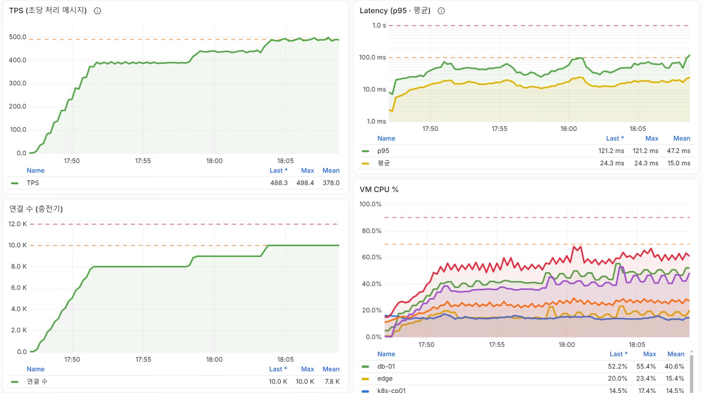
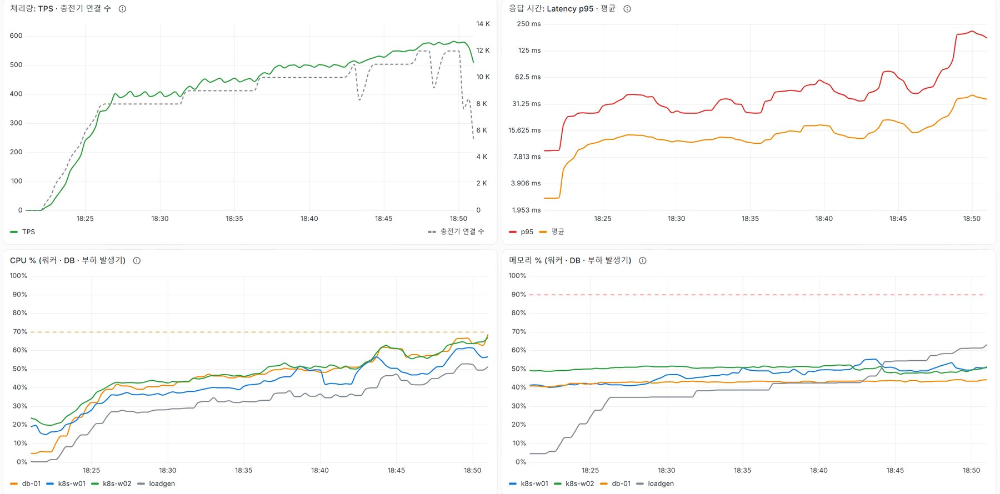
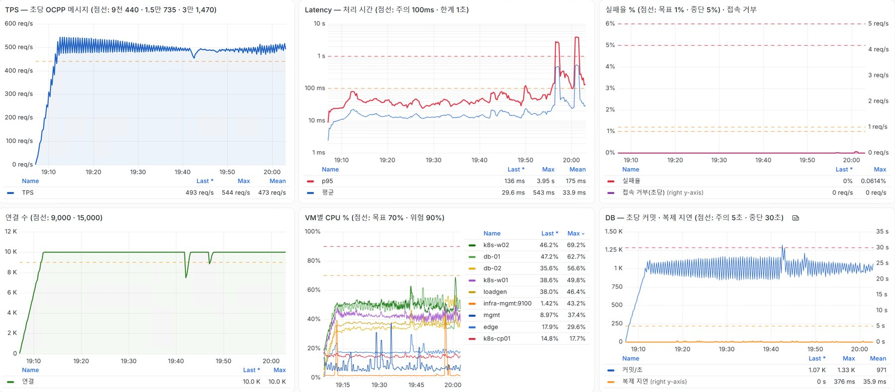

# 부하 테스트 결과 (2026-10-29) — 1차 · 2차 · 3차

- 담당: 강영수 (DB팀). 워커 · 부하 발생기 증설은 인프라 담당(김찬주)과 협의 후 진행
- 대상: 충전기 접속 경로 전체 — edge(nginx mTLS) → CSMS(Pod 4, Argo Rollout) → PgBouncer → PostgreSQL(Patroni, db-01 Primary · db-02 Replica)
- 부하: 가상 충전기(`apps/vcharger`, OCPP 1.6J, 충전기마다 개별 인증서), MeterValues 60초 주기
- 결과서 원본(docx · pdf)과 녹화 영상은 저장소 밖(팀 공유 폴더)에 둔다

## 0. 한눈에

| 구분 | 1차 (09:07 ~ 11:49, 개선 전) | 개선 후 (2차 18:22 ~ 18:51 · 3차 19:07 ~ 20:03) |
|---|---|---|
| 10,000대 30분 지속 부하 p95 | 평균 62.2 ms, 최대 273 ms | **평균 37.7 ms, 최대 81.8 ms** (3차) |
| 정기 배치(MV 갱신) 시점 p95 | 최대 3.76초 | 최대 82 ms |
| 수집기 실행 중 DB 트랜잭션 | 60초 이상 | 약 2초 |
| 12,000대 p95 | 2.94 ~ 4.64초 → 11:20 장애(실패율 최대 61.1%) | **150 ~ 200 ms, 실패 0%** (2차) |
| 12,000대 워커 CPU | 93 ~ 99% | 64 ~ 67% |
| 먼저 한계에 닿은 곳 | K8s 워커 노드 (CSMS) | 물리 호스트 PC (CPU 90 ~ 100%) |
| CSMS Pod 1개 장애 | - | 새 Pod 12초 만에 준비, Pod 3개로도 10,000대 처리 (실패 0%) |
| 부하 중 DB 역할 교대 | - | 쓰기 재개 6.3초 · 원복 7.3초, 충전기 연결 유지, 실패율 최대 0.06% |

운영 권장 최대치는 **10,000대**(지속 부하로 확인, 이때 워커 · DB CPU 약 50%). 12,000대는 짧은 시간 처리만 확인했다.

## 1. 측정 지표 · 판정 기준

| 지표 | 정의 |
|---|---|
| TPS | 초당 처리한 OCPP 메시지 수 |
| Latency p95 | 메시지 수신 → 응답(DB 기록 포함) 처리 시간의 95번째 백분위수. 히스토그램 `chargeops_ocpp_handle_seconds` 기반 추정 |
| 실패율 | 처리 결과가 error · timeout 인 비율 |

| 구분 | 합격 | 중단 |
|---|---|---|
| 단계별 부하 (Step Load) | 각 단계 5분 · p95 ≤ 1초 · 실패율 < 1% · CPU < 70% · TPS 가 예상(대수 × 0.049)을 따라감 | 실패율 > 5% · p95 > 3초 |
| 지속 부하 (Soak) | 30분 이상 · 위 기준 유지 · 복제 지연 < 5초 | 복제 지연 > 30초 · DB Leader 변경 |
| 스트레스 (Stress) | 관찰 (실패 시작 지점, 자동 복구) | 호스트 CPU 90% 1분 · 실패율 5% 1분 · 메모리 90% |

## 2. 1차 (개선 전, 09:07 ~ 11:49)

| 충전기 수 | TPS | p95 (ms) | 워커 CPU w01 / w02 (%) | DB CPU (%) | 실패율 |
|---|---|---|---|---|---|
| 1,000 | 47.8 | 23.8 | 29 / 26 | 12.0 | 0% |
| 5,000 | 236 | 24.1 | 41.7 / 40.3 | 36.3 | 0% |
| 8,000 | 383 | 37.2 | 55.5 / 55.6 | 43.5 | 0% |
| 10,000 | 489 | 88.2 | 59.1 / 68.8 | 49.5 | 0% |
| 12,000 | 599 | 2,940 ~ 4,640 | 91 ~ 99 | 62 (최대 70) | 0% → 11:20 장애 |

- 10,000대 30분 지속 부하(10:34 ~ 11:04): TPS 평균 500, p95 평균 62.2 ms, 실패율 0%, 복제 지연 최대 95 ms → 통과
- 12,000대에서 워커 CPU 포화 + 11:20 정기 배치와 겹쳐 응답 10초 초과 → 충전기가 연결을 끊음(12,000 → 2,280). 부하가 빠진 뒤 약 3분 만에 서버 스스로 정상화(Pod 재시작 없음)
- DB 는 전 구간 CPU 70% 이하, 복제 지연 0, 자동 전환 없음
- 10분마다(:x0) p95 가 튐 → 원인: MV 갱신(7일 전체 재계산 4.3 ~ 5.6초), 공공 API 수집기가 응답을 기다리는 동안 DB 트랜잭션을 열어 둠(09:30 69초)

## 3. 개선 (1차 → 2차 · 3차)

| 항목 | 내용 | 결과 |
|---|---|---|
| MV 증분 갱신 (PR #86) | 10분마다 어제 · 오늘만 계산(매 :x3), 7일 전체는 매일 00:07 | 갱신 3.5 ~ 4.1초 → 0.89 ~ 0.95초, 기존 값과 차이 0 |
| 수집기 v1.2 (PR #87) | API 응답을 다 받은 뒤 트랜잭션 시작(TRUNCATE + COPY), HTTP 상태 코드 로그 | 수집 중 최장 트랜잭션 60초 이상 → 약 2초 |
| 워커 노드 증설 | k8s-w01 · w02 vCPU 2 → 3, 메모리 5 → 8 GB (한 대씩 drain) | |
| 시스템 Pod 분산 | w02 에 몰린 Argo CD Pod 를 w01 로 | 10,000대 워커 CPU 27 / 61% → 52 / 52% |
| 부하 발생기 증설 | loadgen 4 vCPU · 12 GB | 메모리 88% → 62% (12,000대) |

작업 중 장애: 16:59 w01 drain 때 Pod 가 모두 w02 로 몰려 w02 메모리 부족 → CSMS 응답 약 5분 중단, 17:04 K8s 자동 재배치로 복구. **drain 전에 남는 노드의 실제 메모리 사용량을 확인**한다.

## 4. 2차 (18:22 ~ 18:51, 단계별 · 스트레스)



사전 점검(17:47 ~ 18:09, 증설만): 10,000대 p95 평균 47 ms · 최대 121 ms, w02 61% / w01 27% — 일이 한 노드에 몰려 효과가 작았다. 분산 후 2차 진행.

| 충전기 수 | TPS | 예상 | p95 (ms) | 워커 CPU (%) | DB CPU (%) | 실패율 |
|---|---|---|---|---|---|---|
| 8,000 | 382 ~ 394 | 392 | 25 ~ 41 | 43 | 42 ~ 43 | 0% |
| 10,000 | 496 | 490 | 41 (30 ~ 55) | 52 (w01 ≈ w02) | 51 | 0% |
| 11,000 | 566 | 539 | 41 (최대 약 90) | 57 | 58 | 0% |
| 12,000 | 571 | 588 | 150 ~ 200 | 64 ~ 67 | 63 ~ 69 | 0% |



- 18:51 호스트 PC CPU 90 ~ 100% (중단 기준) → 종료. 이 환경에서 더 많은 대수는 의미 있게 시험할 수 없다
- 18:43 ~ 18:52 CSMS 새 버전(revision 13) 카나리 배포가 겹침 → Pod 4개가 교체되는 동안 실패율 0%. 분석 지표 2개가 Failed 인데 배포는 완료됨(분석 단계 dryRun)

## 5. 3차 (19:07 ~ 20:03, 지속 부하 · 장애)

| 시각 | 내용 |
|---|---|
| 19:07 ~ 19:11 | 30초 간격으로 1,000대씩 10,000대 |
| 19:11:36 ~ 19:41:36 | 10,000대 30분 유지 |
| 19:41:56 | CSMS Pod 1개 삭제 (`kubectl delete pod`) |
| 19:46:51 ~ 19:52:47 | CSMS Pod 4 → 3개 (`kubectl -n ops scale rollout csms --replicas=3`), 약 6분 |
| 19:55 ~ 19:56 | Patroni 역할 교대 db-01 → db-02 (`db/ops/patroni/switchover.sh`) |
| 20:00 | 원복 db-02 → db-01 |
| 20:03 | 종료. `pgbackrest check` 로 새 타임라인(9)의 WAL 보관 확인 |



**지속 부하 30분**

| 지표 | 1차 | 3차 |
|---|---|---|
| TPS | 평균 500 | 평균 약 490 |
| p95 | 평균 62.2 ms, 최대 273 ms | 평균 37.7 ms, 최대 81.8 ms |
| 실패율 | 0% | 0% |
| 복제 지연 | 최대 95 ms | 최대 0.38초 |
| 워커 CPU (w02 / w01) | 약 72 / 60% | 약 54 / 45% |
| DB CPU | 약 49% | 약 53% |

**CSMS Pod 장애**

| | Pod 1개 삭제 | Pod 4 → 3개 (N-1) |
|---|---|---|
| Pod | 새 Pod 가 같은 노드(w02)에 생겨 12초 만에 Ready | 새 Pod 없음. 남은 3개(w01 2 · w02 1) |
| 연결 | 약 3,000대 끊김 → 약 1분 안에 10,000 | 약 1,000 ~ 2,000대 끊김 → 약 1분 안에 10,000 |
| 실패율 · p95 | 0% · 재접속 때 약 70 ms | 0% · 최대 124 ms |

**부하 중 DB 역할 교대**

| | db-01 → db-02 | 원복 db-02 → db-01 | 부하 없을 때 (10/28) |
|---|---|---|---|
| 쓰기 재개까지 | 6.3초 | 7.3초 | 4.2초 |
| Primary 두 대 · 데이터 손실 | 0회 · 0 | 0회 · 0 | 0회 · 0 |
| 충전기 연결 | 10,000 유지 | 10,000 유지 | - |
| 실패율 (1분 최대) | 0.023% | 0.061% | - |
| p95 (전환 순간) | 최대 2.89초 | 최대 3.95초 | - |

- 쓰기가 멈춘 6 ~ 7초 동안의 메시지는 대부분 기다렸다가 처리됨 → 1분 p95 가 잠깐 수 초로 오름
- db-02 가 Primary 인 약 4분 동안 p95 약 135 ms (db-01 일 때의 약 2배). db-02 VM 메모리 · shared_buffers 가 db-01 보다 작고, 전환 직후 캐시가 비어 있기 때문으로 본다

## 6. 개선 과제

| 우선 | 과제 | 근거 | 구분 | 상태 |
|---|---|---|---|---|
| 1 | MV 증분 갱신 | 2장 | DB | 완료 (#86) |
| 1 | 수집기 v1.2 | 2장 | DB · 앱 | 완료 (#87, 배포 확인) |
| 1 | 워커 노드 증설 | 2장 | 인프라 | 완료 |
| 1 | Standby(db-02) 사양을 Primary 와 같게 | 5장 DB 교대 | DB · 인프라 | 미진행 |
| 1 | 카나리 분석 dryRun 해제 | 4장 | 인프라 | 미진행 |
| 1 | DB 서버 방화벽 규칙 정리 (담당자에게 별도 전달) | 점검 결과 | 인프라 · DB | 미진행 |
| 2 | 방화벽 Ansible 설정을 저장소로 관리 | 변경 이력 없음 | 인프라 | 미진행 |
| 2 | CSMS Pod 노드 분산 규칙(anti-affinity) · 시스템 Pod 배치 · HPA | 4 · 5장 | 인프라 | 미진행 |
| 2 | 바뀐 VM 사양을 Vagrantfile 에 반영 | 3장 | 인프라 | 미진행 |
| 2 | Prometheus 를 앱과 다른 노드로, 개발 · 운영 노드 분리 | 1차 관찰 | 인프라 | 미진행 |
| 3 | 충전기 재접속 지수 백오프 | 1차 11:20 | 앱 | 미진행 |
| 3 | DB 전환 직후 지연 완화(pg_prewarm 검토) · `charger_status_current` autovacuum 점검 | 5장 · 1차 | DB | 검토 |

## 7. 다시 해 보려면 (mgmt)

```bash
# ===== 실행할 명령어 ===== (mgmt — 시각 기록 · 1,000대 묶음 시작 · 전체 중지)
m(){ date "+%F %T $*" | tee -a ~/lt-time-$(date +%m%d).txt; }
lt(){ k=$1; a=$(( (k-1)*1000+1 )); b=$(( k*1000 )); ssh loadgen "sudo systemd-run --unit=chargeops-vcharger-b$(printf %02d $k) --uid=chargeops --working-directory=/opt/chargeops/apps -p LimitNOFILE=65536 /opt/chargeops/venv/bin/python vcharger/vcharger.py --url wss://edge.chargeops.lab/ocpp --ids $(seq -s, -f 'LT-%04g' $a $b) --ca /opt/chargeops/certs/ca.crt --cert-dir /opt/chargeops/certs/chargers --meter-interval 60 --ramp 50 --reconnect-jitter 30 --control-port $((8081+k))" && m "${b}대-시작 (묶음 b$(printf %02d $k))"; }
lt_stop(){ timeout 120 ssh loadgen 'sudo systemctl stop "chargeops-vcharger-b*"' && m "전체-중지"; }

m "시작"; for k in $(seq 1 10); do lt $k; sleep 30; done     # 10,000대까지
m "종료"; lt_stop
```

- 대시보드: `monitoring/grafana/loadtest-dashboard-v4.json` (Grafana → Import, 데이터 소스 Prometheus 선택)
- 끝나면 `ssh loadgen 'systemctl list-units "chargeops-vcharger-b*" --no-legend | wc -l'` 가 0
- DB 역할 교대 · Pod 수 변경은 **사용자 확인 뒤**에만. 끝나면 `patronictl list`(Leader db-01) · `kubectl -n ops get pods | grep csms`(4개) 로 원상 확인

## 8. 한계

- VM 전부가 물리 호스트 1대를 나눠 쓴다. 부하 발생기도 같은 호스트라 결과는 이 환경 기준
- Pod 장애는 정상 종료 절차가 있는 경우만 시험. 강제 종료 · 워커 노드 장애, DB 단독 부하(pgbench, 별도 서버)는 후속
- 운영 DB 에 시험용 충전기(LT-0001 ~ LT-15000, `source = virtual`)와 시험 인증서가 남아 있다 — 서비스 시작 전 정리
