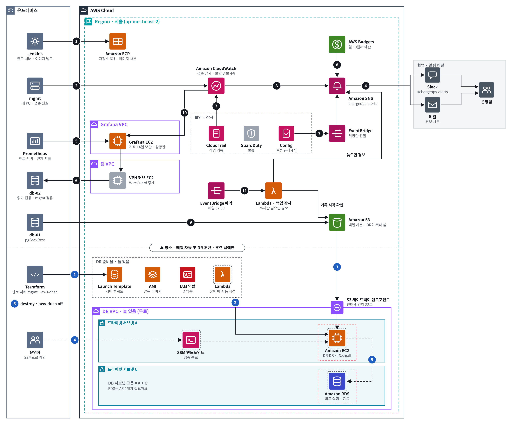

# AWS DR 멘토 서버 실행 기록 (Terraform 장부 S3 이전)

- 담당: 황채연 (AWS)
- 관련 WBS: 4.5 DR 훈련
- 버전: versions.md 참고 (멘토 서버 mgmt: Terraform 1.17.0 · AWS CLI 2.38 · AWS provider 6.69.1 · archive 2.8.1)
- 상태: **2026-10-28 멘토 서버 mgmt 에서 DR 훈련 · RDS 비교 실행 완료** — 복원 124초, RTO 약 2분 17초
- 추가: **2026-10-29 멘토 서버에서 자동 DR 시험 완료 (사람 손 0)** — 신호 끊김부터 복원 끝까지 16분 35초 → 8장
- 관련: [`aws-dr-vpc.md`](aws-dr-vpc.md) (DR VPC · `aws.sh` 코드), [`aws-rds-compare.md`](aws-rds-compare.md) (RDS 비교), [`aws-s3-backup.md`](aws-s3-backup.md) (repo2 = S3 백업), [`aws-backup-watch.md`](aws-backup-watch.md) (백업 감시)

## 0. 결과 요약

| 항목 | 결과 |
|---|---|
| 실행 위치 | 담당자 PC mgmt → **멘토 서버 mgmt** (`~/aws-dr.sh`) |
| Terraform 장부(상태 파일) | mgmt 로컬 파일 → **S3 전용 버킷** `dr/terraform.tfstate` (버전 보관 · 잠금) |
| 옮긴 뒤 확인 | 자원 16개 그대로 (`state list` 비교 `SAME`) · `~/aws-dr.sh status` → No changes |
| DR 훈련 (10:45) | 4개 생성 63초 → 복원 **124초** (내려받기 42초 · WAL 재생·승격 78초) → 정리 4개 300초 |
| RTO | 서버 13초 + 복원 124초 = **약 2분 17초** (앱 접속 전환 시간 별도) |
| RDS 비교 (12:27) | RDS 생성 6분 17초 · 넣기 오류 0 · 행 수 일치 → [`aws-rds-compare.md`](aws-rds-compare.md) |
| RPO | 이 회차는 재지 않음. 같은 날 오전(담당자 PC 실행) 약 17초 |



## 1. 왜 / 무엇을

- DR 실행(Terraform · `aws.sh`)이 담당자 PC mgmt 에만 있었다. PC 가 꺼져 있으면 훈련도 정리(`off`)도 못 하고, 팀원이 대신 실행할 수 없었다
- 운영 서버(멘토 서버) 한 곳에서 백업부터 DR 까지 돌리도록 **실행 위치를 옮긴다**
- Terraform 을 처음부터 다시 만들지 않고 **장부만 S3 로 옮긴다**. 장부 없이 새로 `apply` 하면 이미 있는 자원을 또 만들려다 실패하거나 중복된다
- 장부를 S3 에 두면 어느 mgmt 에서 실행해도 같은 장부를 쓰고, 두 곳에서 동시에 실행하면 잠금이 막는다

```text
담당자 PC mgmt ─(init -migrate-state, 한 번)─▶ S3 장부 버킷  dr/terraform.tfstate  (버전 보관 · 잠금)
                                                     ▲
멘토 서버 mgmt  ~/aws-dr.sh → aws.sh → terraform ─────┘ ─▶ AWS (DR VPC · DR-DB · RDS)
```

| 구성 | 값 |
|---|---|
| 장부 버킷 | `chargeops-dr-tfstate-<계정>` · 외부 공개 차단 4개 · 버전 보관 켬 |
| 장부 경로 | `dr/terraform.tfstate` · 잠금 파일 `dr/terraform.tfstate.tflock` (`use_lockfile`, Terraform 1.10+) |
| 권한 | IAM 사용자 `chargeops-terraform` 인라인 정책 `chargeops-dr-tfstate` — 이 버킷 목록 + `dr/*` 읽기 · 쓰기 · 삭제만 |
| 멘토 서버용 키 | `chargeops-terraform` 의 두 번째 액세스 키 (설명 태그 `mentor-mgmt`) |
| 키 보관 | 멘토 서버 mgmt `~/.chargeops-dr.env` (600) — 공용 `~/.chargeops.env` 와 분리 |

**공용 설정과 분리한 이유** — 멘토 서버의 `~/.chargeops.env` 는 수집기 · 봇 · MinIO 가 같이 읽는 팀 공용 파일이다. `aws.sh` 는 Terraform 키를 전용 이름(`AWS_TF_KEY_ID` · `AWS_TF_SECRET`)으로 읽고, 실행할 때만 `AWS_ACCESS_KEY_ID` 로 바꾼다(`aws.sh` 67~68줄). 그래서 키를 DR 전용 파일에 두고, 실행 파일 `~/aws-dr.sh` 가 그 파일을 읽은 뒤 `aws.sh` 를 실행한다. 기존 `chargeops` 프로필(임시 자격 증명)과 MinIO 설정은 건드리지 않는다.

## 2. 설치 명령어

명령은 영문만 쓴다. 키 · 버킷 이름은 화면에서만 보고 문서 · 채팅 · Git 에 옮기지 않는다.

### 2-1. 장부 버킷 · 권한 (AWS CloudShell, 한 번)

```bash
# ===== 실행할 명령어 =====
ACC=$(aws sts get-caller-identity --query Account --output text); TFB=chargeops-dr-tfstate-$ACC
aws s3api head-bucket --bucket $TFB 2>&1 | tail -n 1      # 404 / Not Found 여야 함. 다른 결과면 멈춤
aws s3api create-bucket --bucket $TFB --region ap-northeast-2 --create-bucket-configuration LocationConstraint=ap-northeast-2
aws s3api put-public-access-block --bucket $TFB --public-access-block-configuration BlockPublicAcls=true,IgnorePublicAcls=true,BlockPublicPolicy=true,RestrictPublicBuckets=true
aws s3api put-bucket-versioning --bucket $TFB --versioning-configuration Status=Enabled
aws s3api get-bucket-versioning --bucket $TFB             # "Status": "Enabled"

cat > /tmp/tfstate-policy.json <<EOF
{
  "Version": "2012-10-17",
  "Statement": [
    {"Sid": "StateList", "Effect": "Allow", "Action": "s3:ListBucket", "Resource": "arn:aws:s3:::$TFB"},
    {"Sid": "StateRW", "Effect": "Allow", "Action": ["s3:GetObject", "s3:PutObject", "s3:DeleteObject"], "Resource": "arn:aws:s3:::$TFB/dr/*"}
  ]
}
EOF
aws iam put-user-policy --user-name chargeops-terraform --policy-name chargeops-dr-tfstate --policy-document file:///tmp/tfstate-policy.json
aws iam list-user-policies --user-name chargeops-terraform --output table   # chargeops-dr-tfstate
```

- 계정 번호는 명령이 채운다. 화면에 나온 버킷 이름은 옮겨 적지 않는다

### 2-2. 장부 옮기기 (담당자 PC mgmt, 한 번)

```bash
# ===== 실행할 명령어 =====
cd ~/chargeops/infra/terraform/dr
cp -p terraform.tfstate ~/tfstate-bak-$(date +%Y%m%d).json && chmod 600 ~/tfstate-bak-*.json   # 되돌리기용 사본
terraform state list > ~/state-before.txt; wc -l ~/state-before.txt

# 이 창에서만 쓰는 함수 (aws.sh 68줄과 같은 방식)
tfa() { ( set +u; source ~/.chargeops.env; unset AWS_CA_BUNDLE AWS_ENDPOINT_URL AWS_ENDPOINT_URL_S3 S3_ENDPOINT_URL AWS_SESSION_TOKEN AWS_PROFILE; export AWS_ACCESS_KEY_ID="$AWS_TF_KEY_ID" AWS_SECRET_ACCESS_KEY="$AWS_TF_SECRET" AWS_REGION=ap-northeast-2 AWS_DEFAULT_REGION=ap-northeast-2; terraform "$@" ); }

printf 'terraform {\n  backend "s3" {}\n}\n' > backend.tf     # 저장소의 backend.tf 와 같음 (실습 묶음에 없을 때만)
read -rp "state bucket name: " TFB                          # 2-1 의 이름을 직접 입력
printf 'bucket       = "%s"\nkey          = "dr/terraform.tfstate"\nregion       = "ap-northeast-2"\nuse_lockfile = true\nencrypt      = true\n' "$TFB" > ~/.chargeops-dr.tfbackend && chmod 600 ~/.chargeops-dr.tfbackend

tfa init -migrate-state -backend-config=$HOME/.chargeops-dr.tfbackend   # "copy existing state to the new backend?" → yes
tfa state list > ~/state-after.txt; wc -l ~/state-after.txt; diff ~/state-before.txt ~/state-after.txt && echo SAME

# 멘토 서버로 넘길 설정 파일 2개 → 장부 버킷 dr/bundle/
export TFB
( set +u; source ~/.chargeops.env; unset AWS_CA_BUNDLE AWS_ENDPOINT_URL AWS_ENDPOINT_URL_S3 S3_ENDPOINT_URL AWS_SESSION_TOKEN AWS_PROFILE; export AWS_ACCESS_KEY_ID="$AWS_TF_KEY_ID" AWS_SECRET_ACCESS_KEY="$AWS_TF_SECRET" AWS_DEFAULT_REGION=ap-northeast-2; ~/venv/bin/python3 -c "import boto3,os; s3=boto3.client('s3'); b=os.environ['TFB']; [s3.upload_file(f, b, 'dr/bundle/'+f.lstrip('.')) for f in ('terraform.tfvars','.terraform.lock.hcl')]; print('UPLOADED')" )
```

- `Successfully configured the backend "s3"!` · 자원 개수 같음 · `SAME` 이면 끝
- 실패하면 되돌리기: `rm -f backend.tf; cp -p ~/tfstate-bak-<날짜>.json terraform.tfstate; terraform init -reconfigure`
- 이후 담당자 PC 에서는 `aws.sh` 를 돌리지 않는다 (아래 5장 Terraform 버전)

### 2-3. 멘토 서버 mgmt 준비 (한 번)

접속은 팀 내부 안내를 따른다. 원격 데스크톱 터미널은 여러 줄을 붙이면 섞이므로 **한 줄씩** 붙인다.

```bash
# ===== 실행할 명령어 =====
# 0) 확인 (읽기만)
ls ~/chargeops/infra/terraform/dr/terraform.tfstate         # No such file → 멘토 서버가 맞음 (로컬 장부 없음)
terraform version; aws --version                            # Terraform 1.10 이상
grep -E "AWS|TF_" ~/.chargeops.env | sed -E 's/=.*/=<hidden>/'   # AWS_TF_* 가 없어야 함 (있으면 겹침 → 멈춤)

# 1) 키: 콘솔 IAM → 사용자 chargeops-terraform → 보안 자격 증명 → 액세스 키 만들기 (CLI · 설명 태그 mentor-mgmt)
read -rp "AWS_TF_KEY_ID: " K; read -rsp "AWS_TF_SECRET: " S; echo
umask 077; printf 'export AWS_TF_KEY_ID=%q\nexport AWS_TF_SECRET=%q\n' "$K" "$S" > ~/.chargeops-dr.env; unset K S; sed -E 's/=.*/=<hidden>/' ~/.chargeops-dr.env

# 2) 장부 위치 (2-2 와 같은 내용) + init 때 자동으로 쓰게
read -rp "state bucket name: " TFB
printf 'bucket       = "%s"\nkey          = "dr/terraform.tfstate"\nregion       = "ap-northeast-2"\nuse_lockfile = true\nencrypt      = true\n' "$TFB" > ~/.chargeops-dr.tfbackend && chmod 600 ~/.chargeops-dr.tfbackend
echo "export TF_CLI_ARGS_init=\"-backend-config=$HOME/.chargeops-dr.tfbackend\"" >> ~/.chargeops-dr.env

# 3) 이 창에서만 쓰는 함수
awsdr() { ( set +u; source ~/.chargeops-dr.env; unset AWS_CA_BUNDLE AWS_ENDPOINT_URL AWS_ENDPOINT_URL_S3 S3_ENDPOINT_URL AWS_SESSION_TOKEN AWS_PROFILE; export AWS_ACCESS_KEY_ID="$AWS_TF_KEY_ID" AWS_SECRET_ACCESS_KEY="$AWS_TF_SECRET" AWS_REGION=ap-northeast-2 AWS_DEFAULT_REGION=ap-northeast-2; "$@" ); }

# 4) 설정 파일 받기 → S3 장부 연결
cd ~/chargeops/infra/terraform/dr && awsdr aws s3 cp s3://$TFB/dr/bundle/terraform.tfvars terraform.tfvars && awsdr aws s3 cp s3://$TFB/dr/bundle/terraform.lock.hcl .terraform.lock.hcl
printf 'terraform {\n  backend "s3" {}\n}\n' > backend.tf     # 저장소에서 받았으면 생략
awsdr terraform init                                        # yes 를 묻으면 넣지 말고 멈춤 (로컬 장부가 있다는 뜻)
awsdr terraform state list | wc -l                          # 16

# 5) 실행 파일
printf '#!/bin/bash\nset -a; source ~/.chargeops-dr.env; set +a\nunset AWS_PROFILE\nexec bash ~/chargeops/deploy/aws/aws.sh "$@"\n' > ~/aws-dr.sh && chmod 700 ~/aws-dr.sh
~/aws-dr.sh status
```

- 멘토 서버에서는 **`aws.sh setup` 을 쓰지 않는다**. setup 은 키를 공용 `~/.chargeops.env` 에 쓴다
- 멘토 서버의 Terraform(1.17.0)은 공용 설치라 버전을 바꾸지 않는다

### 2-4. 훈련 (멘토 서버 mgmt)

```bash
# ===== 실행할 명령어 =====
~/aws-dr.sh status                    # drill=false · enable_rds=false · No changes
date; ~/aws-dr.sh drill start         # Plan 4 to add · 0 to destroy 일 때만 yes
# 3~4분 뒤 콘솔 EC2 → chargeops-dr-db → 연결 → Session Manager →  sudo tail -n 4 /var/log/dr-restore.log
date; ~/aws-dr.sh off                 # 0 to add 일 때만 yes. 3~5분 걸림 (Ctrl+C 금지)
~/aws-dr.sh status
```

- RDS 비교는 `drill start` 대신 `~/aws-dr.sh rds start` → [`aws-rds-compare.md`](aws-rds-compare.md) 2장

## 3. 설정 파일

| 파일 | 위치 | 내용 | git |
|---|---|---|---|
| `infra/terraform/dr/backend.tf` | 저장소 | `backend "s3" {}` — 버킷 이름 없음 | ✅ |
| `~/.chargeops-dr.tfbackend` | 두 mgmt | `bucket` = `<장부 버킷>` · `key` · `region` · `use_lockfile` · `encrypt` | ✗ |
| `~/.chargeops-dr.env` | 멘토 서버 mgmt | `AWS_TF_KEY_ID` · `AWS_TF_SECRET` = `<각자 설정>` · `TF_CLI_ARGS_init` | ✗ |
| `~/aws-dr.sh` | 멘토 서버 mgmt | 위 파일을 읽은 뒤 `aws.sh` 실행 | ✗ |
| `terraform.tfvars` · `.terraform.lock.hcl` | 두 mgmt (사본: 장부 버킷 `dr/bundle/`) | 버킷 · 경로 · 메일 / 플러그인 버전 (aws 6.69.1 · archive 2.8.1) | ✗ (.gitignore) |
| `~/tfstate-bak-20261028.json` | 담당자 PC mgmt | 옮기기 전 장부 사본 | ✗ |

## 4. 확인 방법

```bash
# ===== 실행할 명령어 =====
~/aws-dr.sh status                                                  # 멘토 서버 mgmt
awsdr terraform state list | wc -l                                  # 16
aws s3 ls s3://$TFB/dr/                                             # CloudShell: terraform.tfstate (훈련 중에는 .tflock 도 보임)
```
```
# ===== 실행 결과 요약 (2026-10-28, ID · 주소 · 버킷은 뺌) =====
장부 이전      담당자 PC: Successfully configured the backend "s3" · state list 16 → 16 SAME
멘토 서버      init: Reusing aws 6.69.1 · archive 2.8.1 from the dependency lock file · state list 16
status         drill=false · enable_rds=false · 시간당 요금 없음 · repo2(S3) 설정 db-01=있음 db-02=있음 · No changes
drill start    Plan 4 to add · DR-DB 13s · SSM 엔드포인트 31~42s · 적용 끝 63초
dr-restore     패키지 1초 · 저장소 확인 2초 · 내려받기 42초 · 재생 · 승격 78초 = 합계 124초 · 종료 코드 0
off            4 destroyed · DR-DB 30s · SSM 엔드포인트 3m21s~4m22s · 적용 끝 300초
```

## 5. 막혔던 점

| 증상 | 원인 · 해결 |
|---|---|
| 장부 버킷으로 쓰려던 이름(`chargeops-tfstate-<계정>`)이 이미 있음 | 다른 작업이 쓰는 버킷. 섞이지 않게 `chargeops-dr-tfstate-<계정>` 을 새로 만들고, 권한도 이 버킷 `dr/*` 로만 줌 |
| 멘토 서버 공용 `~/.chargeops.env` 에 키를 넣으면 다른 스크립트와 섞일 위험 | DR 전용 파일 `~/.chargeops-dr.env` + 실행 파일 `~/aws-dr.sh` 로 분리 |
| Terraform 버전이 다름 (담당자 PC 1.16.6 · 멘토 서버 1.17.0) | 공용 설치는 그대로 둠. 새 버전은 옛 장부를 읽을 수 있음 → 이후 멘토 서버에서만 실행. 담당자 PC 에서 다시 쓰려면 1.17 로 올린 뒤 |
| 멘토 PC 에서 `ssh -F .vagrant\ssh-mgmt.conf mgmt` 가 거절됨 | VM 을 띄운 Windows 계정이 달라 키를 못 읽음 → 팀 안내대로 접속 |
| 원격 데스크톱에서 여러 줄을 붙이면 명령이 섞임 | 한 줄씩 붙여넣기 |
| `off` 가 멈춘 것처럼 보임 | SSM 엔드포인트 삭제에 3~5분. `aws.sh` 는 끝날 때까지 진행 문구를 안 보여 줌. Ctrl+C 금지 |
| PowerShell 창을 클릭하면 출력이 멈춤 | 창이 "선택" 모드가 됨 → Esc. 오래 걸리는 명령 앞에 `date;` 를 붙여 시작 시각을 남김 |

## 6. 비용 (서울, 근사치 — 청구서로 확인)

| 무엇 | 언제 | 대략 |
|---|---|---|
| 장부 버킷 (수십 KB · 버전 보관) | 상시 | 월 1센트 미만 |
| 훈련 · RDS 비교 | 훈련 때만 | [`aws-dr-vpc.md`](aws-dr-vpc.md) 6장 · [`aws-rds-compare.md`](aws-rds-compare.md) 6장 |

## 7. 추가 이관 (2026-10-29) — alerts 장부 · 생존 신호

| 항목 | 결과 |
|---|---|
| alerts 장부 | 담당자 PC 로컬 → S3 장부 버킷 `dr/alerts/terraform.tfstate` (기존 권한 `dr/*` 안이라 IAM 정책 변경 없음) |
| 옮긴 뒤 확인 | 자원 8개 그대로 (`SAME`) · 담당자 PC · 멘토 서버 둘 다 plan `No changes` |
| 생존 신호 | 담당자 PC cron → **멘토 서버 mgmt cron** (1분마다, 전용 키 파일) |
| 이관 확인 | 담당자 PC 신호를 끈 뒤(09:58:39) 11분 동안 경보 `OK` 유지 → 멘토 서버 신호만으로 감시됨 |
| 담당자 PC 생존 신호 키 | 비활성화 (삭제 아님) |

```bash
# ===== 실행할 명령어 (멘토 서버 mgmt, 한 줄씩) =====
# 1) alerts 장부 위치 + 이 창에서만 쓰는 함수 (aws-dr.sh 는 DR 장부로 고정이라 따로 씀)
sed 's#"dr/terraform.tfstate"#"dr/alerts/terraform.tfstate"#' ~/.chargeops-dr.tfbackend > ~/.chargeops-alerts.tfbackend && chmod 600 ~/.chargeops-alerts.tfbackend
awsal() { ( set +u; source ~/.chargeops-dr.env; unset AWS_CA_BUNDLE AWS_ENDPOINT_URL AWS_ENDPOINT_URL_S3 S3_ENDPOINT_URL AWS_SESSION_TOKEN AWS_PROFILE; export TF_CLI_ARGS_init="-backend-config=$HOME/.chargeops-alerts.tfbackend" AWS_ACCESS_KEY_ID="$AWS_TF_KEY_ID" AWS_SECRET_ACCESS_KEY="$AWS_TF_SECRET" AWS_REGION=ap-northeast-2 AWS_DEFAULT_REGION=ap-northeast-2; "$@" ); }

# 2) 전용 폴더에 코드 · 설정 받기 → 장부 연결
mkdir -p ~/chargeops-alerts && cd ~/chargeops-alerts && TFB=$(sed -nE 's/^bucket *= *"(.*)"/\1/p' ~/.chargeops-alerts.tfbackend)
awsal aws s3 cp s3://$TFB/dr/bundle/alerts-code/ . --recursive --quiet && awsal aws s3 cp s3://$TFB/dr/bundle/alerts.tfvars terraform.tfvars --quiet && awsal aws s3 cp s3://$TFB/dr/bundle/alerts.lock.hcl .terraform.lock.hcl --quiet && chmod 600 terraform.tfvars
awsal terraform init
awsal terraform state list | wc -l; awsal terraform plan -no-color | grep -E "will be|must be|Plan:|No changes"   # 8 · No changes

# 3) 생존 신호 키: 콘솔 IAM → chargeops-heartbeat → 액세스 키 만들기 (설명 태그 mentor-mgmt, .csv 받지 않음)
read -rp "AWS_HB_KEY_ID: " K; read -rsp "AWS_HB_SECRET: " S; echo
( umask 077; printf 'export AWS_HB_KEY_ID=%q\nexport AWS_HB_SECRET=%q\n' "$K" "$S" > ~/.chargeops-hb.env ); unset K S
bash -c 'source ~/.chargeops-hb.env && ~/venv/bin/python3 ~/chargeops-alerts/aws-heartbeat.py --verbose'; echo EXIT=$?   # EXIT=0

# 4) cron 켜기 · 끄기 파일
echo "* * * * * bash -c 'source ~/.chargeops-hb.env && ~/venv/bin/python3 ~/chargeops-alerts/aws-heartbeat.py' >/dev/null 2>&1 # chargeops-hb" > ~/.chargeops-hb.cron
printf '%s\n' '#!/bin/bash' 'case "$1" in' '  on)  crontab -l 2>/dev/null | grep -q "# chargeops-hb" || ( crontab -l 2>/dev/null; cat ~/.chargeops-hb.cron ) | crontab - ;;' '  off) crontab -l 2>/dev/null | grep -v "# chargeops-hb" | crontab - ;;' 'esac' 'date; echo "heartbeat cron: $(crontab -l 2>/dev/null | grep -c "# chargeops-hb")"' > ~/aws-hb.sh && chmod 700 ~/aws-hb.sh
~/aws-hb.sh on            # heartbeat cron: 1   (끄기: ~/aws-hb.sh off · 확인: ~/aws-hb.sh)
~/aws-dr.sh status        # 생존 신호 경보: OK · cron: 1 줄
```

| 파일 | 위치 | 내용 | git |
|---|---|---|---|
| `~/.chargeops-alerts.tfbackend` | 두 mgmt | DR 과 같은 버킷 · key `dr/alerts/terraform.tfstate` | ✗ |
| `~/chargeops-alerts/` | 멘토 서버 mgmt | alerts 코드 · tfvars · lock (사본: 장부 버킷 `dr/bundle/alerts*`) | ✗ |
| `~/.chargeops-hb.env` | 멘토 서버 mgmt | `AWS_HB_KEY_ID` · `AWS_HB_SECRET` = `<각자 설정>` (권한 600) | ✗ |
| `~/.chargeops-hb.cron` · `~/aws-hb.sh` | 멘토 서버 mgmt | cron 한 줄(`# chargeops-hb`) · 켜기 / 끄기 | ✗ |

| 증상 | 원인 · 해결 |
|---|---|
| 담당자 PC plan 에 예산 `update in-place` 1개 | AWS 가 채우는 기본값(`billing_view_arn` · `metrics`)이 코드에 없음 → `lifecycle.ignore_changes` 추가 → `No changes` |
| `~/aws-dr.sh alerts` 로 못 돌림 | `aws-dr.sh` 가 `TF_CLI_ARGS_init` 으로 DR 장부를 고정 → alerts 는 `awsal` 함수로 따로. `aws.sh` 의 alerts · heartbeat 명령은 공용 `~/.chargeops.env` 를 써서 멘토 서버에서 쓰지 않음 |
| cron 의 `/usr/bin/python3` 에 boto3 없음 | 설치하지 않고 `~/venv/bin/python3` 를 직접 지정 |
| GitHub 코드와 실제 적용 코드가 다름 | `force_destroy` · `ignore_changes` 를 GitHub 에 반영 (PR #83) |

- 생존 신호는 **한 곳에서만** 보낸다. 두 곳이 같은 `Host=mgmt` 로 보내면 한쪽이 죽어도 경보가 안 울린다
- `~/venv` 를 지우거나 다시 만들면 생존 신호가 멈춘다 (5분 뒤 경보)
- 자동 DR 시연 때 신호 끊기: `~/aws-hb.sh off` → 끝나면 `~/aws-hb.sh on`

## 8. 자동 DR 시험 (2026-10-29) — 팀 계정 · 멘토 서버

생존 신호를 일부러 끊어, 사람이 명령을 치지 않아도 DR-DB 가 뜨고 S3 백업으로 복원되는지 팀 계정에서 확인했다. 앞선 시험(10/15)은 개인 계정이었다 → [`aws-dr-vpc.md`](aws-dr-vpc.md) 2-4

흐름: 생존 신호 끊김 → CloudWatch 경보 `chargeops-mgmt-heartbeat` (1분 × 5개 연속 누락) → SNS `chargeops-alerts` → Lambda `chargeops-auto-dr` → 서버 설계도(Launch Template)로 DR-DB 1대 → 첫 부팅에 S3 복원 (훈련 모드)

| 시각 (KST) | 한 일 | 결과 |
|---|---|---|
| 19:02:45 | `~/aws-dr.sh auto-dr on` | Plan 9 to add → 적용 71초 (Lambda · 역할 · 정책 · 로그 · 권한 · SNS 구독 + SSM 엔드포인트 3) |
| 19:06:12 | `~/aws-hb.sh off` | `heartbeat cron: 0` — 시험 시작 |
| 19:17:31 | (자동) 경보 `ALARM` | Slack #chargeops-alerts · 메일 |
| 19:17:33 | (자동) Lambda | `자동 DR 발동: i-…` → DR-DB 생성 · 메일 "[ChargeOps] 자동 DR 발동 (훈련 모드)" |
| 19:18:29 | (자동) DR-DB 복원 시작 | S3 repo2 · 10/29 03:40 증분 백업 |
| 19:22:47 | (자동) 복원 끝 | 종료 코드 0 |
| 19:25:48 | `~/aws-hb.sh on` | `heartbeat cron: 1` |
| 정리 | 콘솔에서 Lambda 가 띄운 DR-DB 종료 → `~/aws-dr.sh auto-dr off` (19:27:52) | 9 destroyed · 221초 → `status` No changes |

| 항목 | 결과 |
|---|---|
| 감지 (신호 끊김 → 경보) | 11분 19초 |
| 경보 → DR-DB 생성 | 2초 |
| 복원 | 패키지 2초 · 저장소 확인 0초 · 내려받기 43초 · 재생 · 승격 214초 = **260초** |
| 전체 (사람 손 0) | 신호 끊김 → 복원 끝 **16분 35초** |
| RPO | 약 31초 (되살린 마지막 트랜잭션 19:22:15 · 확인 19:22:46) |
| 데이터 | 충전기 541,292 · 상태 이력 1,505,650 (19:22 기준) |
| 정리 뒤 | `auto_dr=false` · 시간당 요금 없음 · 생존 신호 경보 OK · No changes |

- 감지가 설정(5분)보다 두 배 넘게 걸렸다. 전체 16분 35초 중 3분의 2 가 감지 시간이다
- Lambda 는 두 번 실행됐다. 두 번째는 자기가 보낸 "자동 DR 발동" 알림을 받은 것이고, 경보 메시지가 아니어서 무시했다 (`auto_dr.py` 안전장치 ①)
- 재생 · 승격 214초는 같은 날 오후 수동 훈련(149초)보다 길다. 백업(03:40) 뒤 시간이 지날수록 다시 적용할 WAL 이 늘어난다 (10/28 과 같은 경향)
- Lambda 가 띄운 DR-DB 는 Terraform 밖 자원이라 `auto-dr off` 로 지워지지 않는다 → 콘솔에서 태그 `LaunchedBy=auto-dr-lambda` 서버를 직접 종료
- `aws.sh` 안내 문구의 `aws.sh heartbeat on/off` 는 공용 `~/.chargeops.env` 를 읽는다 → 멘토 서버에서는 `~/aws-hb.sh on/off` 만 쓴다
- 신호를 끊으면 팀 Slack 에 경보가 가므로 시험 전에 공지한다

## 9. 다음

- 프로젝트 끝 정리 순서
  1. `~/aws-hb.sh off`
  2. `~/aws-dr.sh status` 로 `auto_dr=false` 확인
  3. DR 스택 destroy — `aws.sh destroy` 가 alerts 스택도 건드리는지 먼저 확인한 뒤 실행
  4. alerts 스택: `~/chargeops-alerts` 에서 `awsal terraform destroy` (`force_destroy` 로 생존 신호 키도 같이 삭제)
  5. 장부 버킷 비우고 삭제 (`dr/` · `dr/alerts/` · `dr/bundle/`)
  6. `chargeops-terraform` 키 2개 비활성화 (destroy 가 끝난 뒤)
  7. 파일 삭제 — 멘토 서버: `~/.chargeops-dr.env` · `~/.chargeops-dr.tfbackend` · `~/aws-dr.sh` · `~/.chargeops-alerts.tfbackend` · `~/chargeops-alerts` · `~/.chargeops-hb.env` · `~/.chargeops-hb.cron` · `~/aws-hb.sh` / 담당자 PC: `~/tfstate-bak-*` · `~/tfstate-alerts-bak-*`
