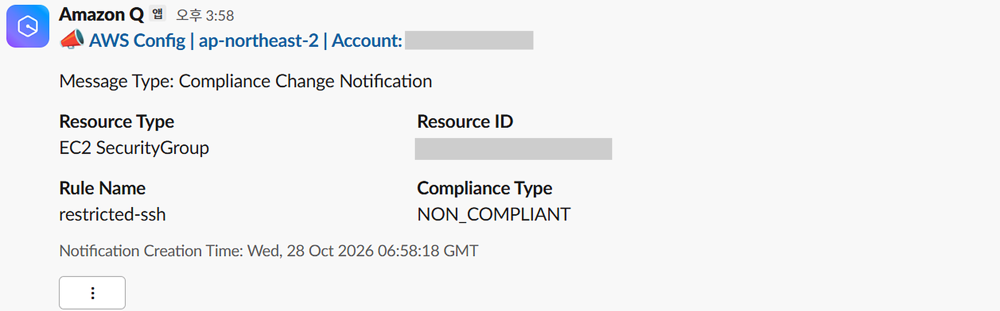

# AWS 보안 · 감사 경보 설치 기록 (CloudTrail · Config → SNS → 메일 · Slack)

- 담당: 황채연 (AWS)
- 관련 WBS: 2.2 후속 (AWS 경보 · 보안 감사)
- 버전: versions.md 참고 (AWS 콘솔 · AWS CLI v2)
- 상태: **2026-10-28 확인** — 보안 경보 4종 · 생존 신호 경보 모두 OK, 알림 대상 전부 `chargeops-alerts`, Config 규칙 4개 동작. **10/28 15:58 재시험으로 Config 미준수 → Slack · 메일 수신 확인** (전달 실패 원인 수정 후, 5장)
- 관련: [`aws-dr-vpc.md`](aws-dr-vpc.md) (SNS `chargeops-alerts` · 생존 신호 · 예산 = alerts 스택 Terraform), [`aws-backup-watch.md`](aws-backup-watch.md) (백업 감시도 같은 토픽)

## 0. 결과 요약

| 무엇 | 이름 | 상태 (10/28) |
|---|---|---|
| 작업 기록 | CloudTrail `chargeops-events` | 전 리전 기록 ✅ · 로그 파일 위조 검사 ✅ · CloudWatch Logs 연결 ✅ |
| 보안 경보 4종 | `chargeops-sec-RootUsage` · `-CloudTrailChanges` · `-ConsoleLoginFailures` · `-SecurityGroupChanges` | 모두 OK · 대상 `chargeops-alerts` |
| 설정 점검 | Config 규칙 4개 | 미준수만 EventBridge `chargeops-config-noncompliant` → `chargeops-alerts` |
| 알림 채널 | SNS `chargeops-alerts` | 메일 + https(Amazon Q Developer → Slack `#chargeops-alerts`) |
| GuardDuty | — | 보류 (`list-detectors` 결과 없음) |

| 시험 | 결과 |
|---|---|
| 일부러 SSH 전체 공개 보안 그룹을 만들었다 지움 (처음) | Config `restricted-ssh` 미준수 → EventBridge → SNS 메일 수신 (당시 대상은 옛 토픽 `chargeops-ops-alerts`) |
| 10/28 재시험 ① 보안 그룹 변경 경보 | 15:44 보안 그룹 생성 · 규칙 추가 → 15:46 `chargeops-sec-SecurityGroupChanges` ALARM, **Slack · 메일 둘 다 수신** (변경 2건 집계, 약 2분) |
| 10/28 재시험 ② Config 1차 | 약 6분 뒤 미준수 판정, 하지만 **알림이 안 옴** — EventBridge 전달 실패 1건 (원인 · 해결은 5장) |
| 10/28 재시험 ③ Config 2차 (수정 후) | 보안 그룹을 다시 만들고 2분 안에 판정 → 15:58 **Slack 에 AWS Config 카드 · 메일(JSON) 수신** ✅ |
| 10/21 밤 실제 `RootUsage` 경보 | 확인 결과 계정 주인의 비밀번호 재설정 로그인 (침입 아님) → 경보가 실제로 동작함을 확인 |




## 1. 왜 / 무엇을

- AWS 에서 누가 무엇을 했는지 남기고(CloudTrail), **위험한 행동이나 잘못된 설정이 생기면 바로 알림**이 오게 한다
- 모든 알림은 SNS `chargeops-alerts` 한 곳으로 모은다 (생존 신호 · 예산 · 백업 감시와 같은 곳) → 메일 · Slack

```text
CloudTrail chargeops-events (전 리전) ─▶ CloudWatch Logs chargeops-cloudtrail (30일)
      ─▶ 지표 필터 4개 (ChargeOps/Security) ─▶ 경보 chargeops-sec-* ─┐
Config 규칙 4개 ─▶ EventBridge chargeops-config-noncompliant (미준수만) ─┼─▶ SNS chargeops-alerts ─┬─▶ 메일
생존 신호 · 예산 (alerts 스택) · 백업 감시 Lambda ────────────────────┘                        └─▶ Amazon Q → Slack #chargeops-alerts
```

**보안 경보 4종** (CIS AWS 보안 기준의 표준 패턴)

| 경보 | 잡는 것 | 왜 |
|---|---|---|
| `chargeops-sec-RootUsage` | root 계정 로그인 · 작업 | root 는 평소에 쓰면 안 되는 계정 |
| `chargeops-sec-CloudTrailChanges` | 기록 만들기 · 바꾸기 · 지우기 · 켜기 · 끄기 | 침입자가 흔적을 지울 때 먼저 하는 일 |
| `chargeops-sec-ConsoleLoginFailures` | 콘솔 로그인 실패 | 비밀번호 추측 공격 신호 |
| `chargeops-sec-SecurityGroupChanges` | 보안 그룹 만들기 · 지우기 · 규칙 추가 · 삭제 | "SSH 전체 공개" 같은 실수를 바로 잡음 |

- 경보 조건 (4개 같음): 5분 합계 ≥ 1 · 데이터 포인트 1/1 · 데이터 없음 = 정상 · 동작 = SNS `chargeops-alerts`
- EventBridge 가 아니라 CloudWatch Logs 지표 필터로 한 이유: root · IAM 같은 전역 이벤트는 버지니아(us-east-1) 리전에만 온다. 전 리전 CloudTrail 이 서울 로그 그룹 한 곳에 모아 주므로 서울에서 바로 잡힌다
- IAM 정책 변경 경보는 넣지 않았다. Terraform(`aws.sh`)을 돌릴 때마다 울려 알림이 너무 많아진다

**Config 규칙 4개** — 우리 자원(감사 기록 · 접속 · 계정 · 백업 버킷)마다 하나씩

| 규칙 | AWS 관리형 규칙 | 미준수가 뜻하는 것 |
|---|---|---|
| `cloudtrail-enabled` | `CLOUD_TRAIL_ENABLED` | 작업 기록이 꺼짐 |
| `restricted-ssh` | `INCOMING_SSH_DISABLED` | 보안 그룹이 SSH(22)를 전체(0.0.0.0/0)에 엶 |
| `root-account-mfa-enabled` | `ROOT_ACCOUNT_MFA_ENABLED` | root 계정에 2단계 인증이 없음 |
| `s3-bucket-public-read-prohibited` | `S3_BUCKET_PUBLIC_READ_PROHIBITED` | 버킷(백업 등)을 누구나 읽을 수 있음 |

- Config 기록 대상은 요금 때문에 5종만: `AWS::S3::Bucket` · `AWS::EC2::SecurityGroup` · `AWS::EC2::Instance` · `AWS::RDS::DBInstance` · `AWS::CloudTrail::Trail` (전역 자원 제외)
- GuardDuty 는 계정 플랜 제약으로 보류. 코드는 alerts 스택에 있다 (`enable_guardduty`, 기본 끔)

## 2. 설치 명령어

처음에는 **AWS 콘솔**에서 만들었다. 아래는 같은 설정을 다시 만들 때 쓰는 명령이다 (CloudShell, 서울).

### 2-1. CloudTrail → CloudWatch Logs (콘솔)

1. CloudTrail → 추적 → `chargeops-events` → CloudWatch Logs 편집 → 활성화 · 로그 그룹 새로 만들기 `chargeops-cloudtrail` · IAM 역할 새로 만들기 `chargeops-cloudtrail-to-cwlogs` → 저장
2. CloudWatch → 로그 그룹 `chargeops-cloudtrail` → 보존 설정 편집 → **30일** (원본은 S3 에 그대로)
3. 5~15분 뒤 로그 스트림 `<계정>_CloudTrail_ap-northeast-2` 가 생기면 성공

### 2-2. 지표 필터 4개 · 경보 4개

```bash
# ===== 실행할 명령어 =====
LG=chargeops-cloudtrail; NS=ChargeOps/Security
T=$(aws sns list-topics --query "Topics[?ends_with(TopicArn, ':chargeops-alerts')].TopicArn" --output text)
aws logs put-metric-filter --log-group-name $LG --filter-name RootUsage --metric-transformations metricName=RootUsage,metricNamespace=$NS,metricValue=1,defaultValue=0,unit=Count --filter-pattern '{ $.userIdentity.type = "Root" && $.userIdentity.invokedBy NOT EXISTS && $.eventType != "AwsServiceEvent" }'
aws logs put-metric-filter --log-group-name $LG --filter-name CloudTrailChanges --metric-transformations metricName=CloudTrailChanges,metricNamespace=$NS,metricValue=1,defaultValue=0,unit=Count --filter-pattern '{ ($.eventName = CreateTrail) || ($.eventName = UpdateTrail) || ($.eventName = DeleteTrail) || ($.eventName = StartLogging) || ($.eventName = StopLogging) }'
aws logs put-metric-filter --log-group-name $LG --filter-name ConsoleLoginFailures --metric-transformations metricName=ConsoleLoginFailures,metricNamespace=$NS,metricValue=1,defaultValue=0,unit=Count --filter-pattern '{ ($.eventName = ConsoleLogin) && ($.errorMessage = "Failed authentication") }'
aws logs put-metric-filter --log-group-name $LG --filter-name SecurityGroupChanges --metric-transformations metricName=SecurityGroupChanges,metricNamespace=$NS,metricValue=1,defaultValue=0,unit=Count --filter-pattern '{ ($.eventName = AuthorizeSecurityGroupIngress) || ($.eventName = AuthorizeSecurityGroupEgress) || ($.eventName = RevokeSecurityGroupIngress) || ($.eventName = RevokeSecurityGroupEgress) || ($.eventName = CreateSecurityGroup) || ($.eventName = DeleteSecurityGroup) }'
for M in RootUsage CloudTrailChanges ConsoleLoginFailures SecurityGroupChanges; do aws cloudwatch put-metric-alarm --alarm-name chargeops-sec-$M --namespace $NS --metric-name $M --statistic Sum --period 300 --evaluation-periods 1 --datapoints-to-alarm 1 --threshold 1 --comparison-operator GreaterThanOrEqualToThreshold --treat-missing-data notBreaching --alarm-actions $T; done
```

- 지표 필터는 만든 뒤 들어온 기록만 센다. 처음에 경보가 "데이터 부족"이면 몇 분 뒤 OK 로 바뀐다

### 2-3. Config 규칙 4개 · 미준수 → SNS

Config 기록기는 콘솔(Config → 설정)에서 켜고, 기록 대상을 1장의 5종으로 고른다.

```bash
# ===== 실행할 명령어 =====
for R in "cloudtrail-enabled CLOUD_TRAIL_ENABLED" "restricted-ssh INCOMING_SSH_DISABLED" "root-account-mfa-enabled ROOT_ACCOUNT_MFA_ENABLED" "s3-bucket-public-read-prohibited S3_BUCKET_PUBLIC_READ_PROHIBITED"; do set -- $R; aws configservice put-config-rule --config-rule "{\"ConfigRuleName\":\"$1\",\"Source\":{\"Owner\":\"AWS\",\"SourceIdentifier\":\"$2\"}}"; done
aws events put-rule --name chargeops-config-noncompliant --state ENABLED --event-pattern '{"source":["aws.config"],"detail-type":["Config Rules Compliance Change"],"detail":{"messageType":["ComplianceChangeNotification"],"newEvaluationResult":{"complianceType":["NON_COMPLIANT"]}}}'
aws events put-targets --rule chargeops-config-noncompliant --targets "Id=sns,Arn=$T"
```

- `chargeops-alerts` 토픽 정책에 `events.amazonaws.com` 발송 허락이 이미 있다 (alerts 스택 `aws_sns_topic_policy`)
- 대상은 **역할(RoleArn) 없이** 등록한다. 토픽 정책으로 보낸다. 콘솔에서 대상을 만들면 `Amazon_EventBridge_Invoke_Sns_<숫자>` 역할이 자동으로 붙는데, 그 역할은 만들 때 고른 토픽에만 보낼 수 있다 (5장)
- 상태가 **미준수로 바뀔 때만** 알림이 온다. 이미 미준수인 자원은 다시 알리지 않는다

### 2-4. Slack (콘솔)

Amazon Q Developer in chat applications → Slack 워크스페이스 연결(브라우저 승인) → 채널 설정 `chargeops-ops-alerts-slack` → 채널 `#chargeops-alerts` · SNS 토픽 `chargeops-alerts`. 워크스페이스 승인이 브라우저에서만 돼 Terraform 으로 하지 않는다.

## 3. 설정 파일

콘솔 · CLI 로 만든 자원이라 Terraform 코드가 없다. **`aws.sh destroy` 로 지워지지 않는다** (7장).

| 자원 | 이름 | 비고 |
|---|---|---|
| CloudTrail | `chargeops-events` | 전 리전 · 로그 파일 검증 · S3 + CloudWatch Logs |
| 로그 그룹 · 역할 | `chargeops-cloudtrail` (30일) · `chargeops-cloudtrail-to-cwlogs` | |
| 지표 필터 · 경보 | 네임스페이스 `ChargeOps/Security` · `chargeops-sec-*` 4개 | 2-2 |
| Config | 기록기 (5종) · 규칙 4개 · 기록 버킷 `config-bucket-<계정>` | |
| EventBridge | `chargeops-config-noncompliant` | 2-3 패턴 · 대상 `chargeops-alerts` · 역할 없음 (10/28 수정) |
| SNS · 메일 구독 | `chargeops-alerts` | alerts 스택 Terraform ([`aws-dr-vpc.md`](aws-dr-vpc.md) 2-3) |
| Slack | Amazon Q 설정 `chargeops-ops-alerts-slack` → `#chargeops-alerts` | |

## 4. 확인 방법

```bash
# ===== 실행할 명령어 =====
aws cloudtrail describe-trails --query "trailList[].[Name,IsMultiRegionTrail,LogFileValidationEnabled,CloudWatchLogsLogGroupArn!=null]" --output table
aws cloudwatch describe-alarms --query "MetricAlarms[].[AlarmName,MetricName,StateValue]" --output table
aws cloudwatch describe-alarms --query "MetricAlarms[].[AlarmName,AlarmActions[0]]" --output text | awk -F'\t' '{n=split($2,a,":"); print $1, a[n]}'
aws configservice describe-config-rules --query "ConfigRules[].[ConfigRuleName,Source.SourceIdentifier]" --output table
aws events list-targets-by-rule --rule chargeops-config-noncompliant --query "Targets[].Arn" --output text | tr '\t' '\n' | awk -F: '{print $NF}'
aws events list-targets-by-rule --rule chargeops-config-noncompliant --query 'Targets[].RoleArn!=`null`' --output text
aws sns list-subscriptions --query "Subscriptions[].[Protocol,TopicArn]" --output text | awk '{n=split($2,a,":"); print $1, a[n]}' | grep chargeops-alerts
aws guardduty list-detectors --output text
```
```
# ===== 실행 결과 요약 (2026-10-28, 계정 번호 · 메일 주소는 뺌) =====
CloudTrail   chargeops-events | True | True | True
경보         chargeops-mgmt-heartbeat · chargeops-sec-CloudTrailChanges · -ConsoleLoginFailures · -RootUsage · -SecurityGroupChanges → 모두 OK · 대상 chargeops-alerts
Config 규칙  cloudtrail-enabled · restricted-ssh · root-account-mfa-enabled · s3-bucket-public-read-prohibited
EventBridge  chargeops-config-noncompliant → chargeops-alerts · 역할 False (10/28 수정 후)
SNS 구독     email chargeops-alerts · https chargeops-alerts
GuardDuty    (없음)
```

**시험** — 보안 그룹 `chargeops-test-ssh-open` 을 SSH `0.0.0.0/0` 로 만들고 기다린다 → Config `restricted-ssh` 미준수 → 메일 · Slack 확인 → **바로 삭제**. 서버에 붙이지 않은 보안 그룹이라 실제로 열리는 문은 없다. 팀 규칙은 "0.0.0.0/0 금지"라서 **팀 채널에 먼저 알리고, 15분 안에 지운다.** CloudShell 탭이 `ap-northeast-2` 인지 먼저 본다.

```bash
# ===== 실행할 명령어 (CloudShell, 서울) =====
SG=$(aws ec2 create-security-group --group-name chargeops-test-ssh-open --description "config test - delete after" --query GroupId --output text) && echo created
aws ec2 authorize-security-group-ingress --group-id "$SG" --protocol tcp --port 22 --cidr 0.0.0.0/0 --query Return --output text
date
# 1~2분마다: 1 이 나오면 미준수 판정
aws configservice get-compliance-details-by-config-rule --config-rule-name restricted-ssh --compliance-types NON_COMPLIANT --query "EvaluationResults[].EvaluationResultIdentifier.EvaluationResultQualifier.ResourceId" --output text | grep -c "$SG"
# 알림 확인 즉시 (또는 15분이 지나면 무조건) 삭제 → 0 이면 끝
aws ec2 delete-security-group --group-id "$SG"
aws ec2 describe-security-groups --filters Name=group-name,Values=chargeops-test-ssh-open --query "length(SecurityGroups)" --output text
# 알림이 안 오면: EventBridge 가 받았는지 · 보내다 실패했는지 (시각은 UTC 로 바꿔 넣는다)
for M in TriggeredRules Invocations FailedInvocations; do echo "$M: $(aws cloudwatch get-metric-statistics --namespace AWS/Events --metric-name $M --dimensions Name=RuleName,Value=chargeops-config-noncompliant --start-time <시작 UTC> --end-time <끝 UTC> --period 300 --statistics Sum --query 'Datapoints[].Sum' --output text)"; done
```

## 5. 막혔던 점

| 증상 | 원인 · 해결 |
|---|---|
| 알림 토픽이 두 개로 나뉨 (콘솔에서 만든 `chargeops-ops-alerts` · Terraform 의 `chargeops-alerts`) | 경보 4종 · EventBridge 대상을 `chargeops-alerts` 하나로 모음 (4장 결과). 옛 토픽은 메일 구독만 남아 있음 → 7장 |
| 로그 스트림이 비어 있음 | CloudTrail 이 몇 분씩 모아 보냄. 5~15분 기다리면 들어옴 |
| 지표 필터 만들 때 차원을 넣으면 기본값 오류 | 차원은 비워 둠 (기본값 0 이 있어야 "데이터 없음"으로 헷갈리지 않음) |
| **토픽을 `chargeops-alerts` 로 바꾼 뒤 Config 알림이 안 옴** (10/28 재시험에서 발견) | Config 판정 ✅ → EventBridge `TriggeredRules` 1 · `Invocations` 1 · **`FailedInvocations` 1**. 토픽 정책 · 암호화(없음) · 대상 주소는 정상이었고, 대상에 콘솔이 만든 역할 `Amazon_EventBridge_Invoke_Sns_<숫자>` 가 붙어 있었음. 그 역할은 **옛 토픽 `chargeops-ops-alerts` 에만** 보낼 수 있어서 거절됨 → 대상 설정을 백업한 뒤 같은 Id · 같은 토픽으로 **역할 없이** 다시 등록 (`put-targets`) → 재시험에서 Slack · 메일 수신 |
| Config 알림 메일이 JSON 그대로 옴 | 메일은 그대로 둠 (입력 변환기 미적용). Slack 은 Amazon Q 가 **AWS Config 카드**로 정리해서 보여 줌 (10/28 확인) |
| CloudShell 에서 Config · EventBridge 규칙이 "없다"고 나옴 | CloudShell 탭이 버지니아(`us-east-1`)로 열려 있었음 → 콘솔 지역을 서울로 바꾸고 탭 이름 `ap-northeast-2` 확인 |
| 10/21 밤 root 로그인 경보 | 계정 주인의 비밀번호 재설정 로그인으로 확인. 침입 아님 |
| (주의) 알림은 실시간이 아님 | 보안 그룹 변경 경보 약 2분 (CloudTrail → Logs → 5분 집계), Config 미준수 2~6분 (기록 → 규칙 검사 → EventBridge). AWS 가 시간을 보장하지는 않음 |

## 6. 비용 (서울, 근사치 — 청구서로 확인)

| 무엇 | 언제 | 대략 |
|---|---|---|
| CloudTrail 관리 이벤트 (추적 1개) | 상시 | 무료 |
| CloudWatch Logs 수집 · 30일 보관 | 상시 | 월 1달러 미만 |
| 경보 5개 · 사용자 지표 5개 | 상시 | 무료 범위 (각 10개) |
| Config 기록 (5종만) · 규칙 4개 평가 | 상시 | 월 1달러 미만 — 기록 대상을 늘리면 오름 |

## 7. 다음

- 옛 토픽 `chargeops-ops-alerts` (메일 구독만 남음) 정리 — 구독자 확인 후
- GuardDuty — 계정 플랜이 바뀌면 `enable_guardduty=true`
- 프로젝트 끝: Config **기록 중지**(요금), 콘솔로 만든 자원(경보 · 지표 필터 · EventBridge 규칙 · CloudWatch Logs 연결)은 Terraform 밖이라 직접 지움
- 프로젝트 끝: 더 이상 안 쓰는 역할 `Amazon_EventBridge_Invoke_Sns_<숫자>` 와 그 정책 삭제, CloudShell 의 대상 백업 파일 `~/eb-target-backup-1028.json` 삭제
